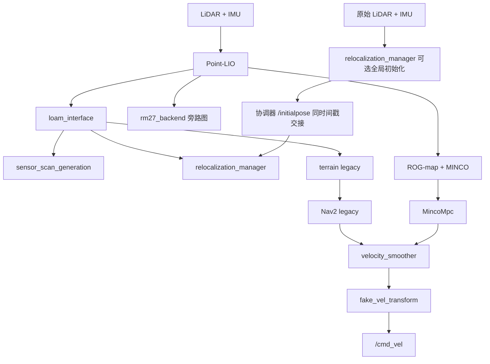

# RM27 哨兵导航

[English](README_en.md) · [AI 开发指南](AGENTS.md) · [审查记录](docs/repository_review_2026-11-05.md)

PnX RoboMaster RM27 导航工作区，基于 PolarBear/PB2025 导航框架继续开发，包含 Livox MID360 激光惯性里程计、先验地图定位、Nav2 导航、ROG-map + MINCO + MPC，以及 Gazebo 仿真。

**当前源码面向 Ubuntu 24.04、ROS 2 Jazzy、Gazebo Harmonic。** 根目录 Dockerfile 和 CI 仍沿用 Humble 配置，尚未与当前完整工作区对齐。本文以当前 launch、CMake 和 YAML 为准；历史文档中的参数及验收结果需要结合对应版本阅读。

## 1. 功能与运行模式

定位来源与导航模式分别选择：`use_ground_truth_odom` 决定仿真定位来源，`navigation_mode` 决定规划控制链。

| 场景 | 关键参数 | 实际行为 |
| --- | --- | --- |
| 默认仿真 | `slam:=false use_ground_truth_odom:=true navigation_mode:=legacy` | Gazebo 真值定位，旧版 Nav2 规划控制；用于导航与物理仿真检查 |
| Point-LIO 导航 | `slam:=false use_ground_truth_odom:=false` | Point-LIO + 局部 GICP 先验匹配；导航可选 `legacy` 或 `minco` |
| 全局初始化 | MINCO YAML 中 `global_relocalization.enabled: true` | RMUC2027、MINCO、原始 LiDAR/IMU 全局检索、停车确认、同时间戳位姿交接，再开放导航 |
| 在线建图 | `slam:=true use_ground_truth_odom:=false navigation_mode:=legacy` | Point-LIO + slam_toolbox；保存二维地图及 Point-LIO 点云 |
| 独立后端 | YAML 中 `rm27_backend.enabled: true` | Point-LIO 原子扫描、关键帧、有界 iSAM2 里程计图；当前旁路输出，不发布 TF |

`legacy` 使用 `GridBased`/ThetaStar 与 `FollowPath`/Omni PID，动态障碍来自 terrain 链。`minco` 使用 `MincoPlanner`、ROG-map 与 `MincoMpc`，是平面轨迹规划和 SE(2) MPC，不能等同于完整三维规划。两种模式在启动时选择；当前没有在线自动回退，旧 `minco_shadow` 模式已移除。

当前四份部署 YAML 均启用后端配置，普通定位 launch 在 Point-LIO 模式下按该开关启动后端；真值模式跳过。后端仅接入首帧规范先验和里程计边，地图/回环因子虽有接口和测试，尚无实际测量生产者，**不能宣称它已消除前端漂移**。详见 [后端说明](src/pnx-localization/backend/README.md) 和 [后端验收](src/pnx-localization/backend/VALIDATION.md)。

## 2. 仓库结构与数据流

| 目录 | 内容 |
| --- | --- |
| `src/pnx-launch/` | `launch_bringup` 启动、四份导航配置、地图/PCD、BT、RViz；`pnx_sentry_nav` 功能集合包；机器人描述与 `ros_interfaces` |
| `src/pnx-localization/` | Point-LIO、局部重定位管理器、全局重定位及 action 接口、里程计转换、扫描生成、独立后端及原子帧接口 |
| `src/pnx-navigation/` | `minco_planner`、`minco_controller`、`fake_vel_transform`；旧版控制器子模块 |
| `src/pnx-perception/` | ROG-map、terrain 节点；Nav2 插件及点云转扫描子模块 |
| `src/pnx-stimulation/` | `rm_27_stimulation` Harmonic 仿真、`ign_sim_pointcloud_tool` 点云转换、`rm27_rendering` 渲染辅助 |
| `src/livox_ros_driver2/` | Livox 驱动子模块 |
| `src/tools/map_edit/` | 地图编辑 ROS 包 |
| `tools/global_relocalization/` | 独立构建/启动、地图来源审计、采集、回放、评估及 station submaps 实验 |
| `tools/mapping/` | Point-LIO 导出、ERASOR2、CAD 点云与对齐检查；不属于默认 colcon 构建 |
| `tools/stimulation/` | 仿真、初始化、里程计和后端基准脚本；目录名保留项目现有拼写 |
| `docs/` | 架构、调参、历史验证及地图来源记录 |

目录名不总等于 ROS 包名：`backend` 对应 `rm27_backend`，`localization_interfaces` 对应 `rm27_localization_interfaces`。以 `package.xml` 和 `colcon list --base-paths src` 为准。



这是 Point-LIO 模式的数据关系图。真值模式由 `rm27_ground_truth_localizer` 提供导航定位输入；SLAM 模式由 slam_toolbox 管理 `map → odom`。

常用话题：

- 仿真传感器：`/livox/lidar`、`/livox/imu`；点云转换器输出带 `ring/time` 的 `/velodyne_points`。GPU 扫描按瞬时帧处理，不能直接用它证明实车扫描去畸变正确。
- Point-LIO：`/aft_mapped_to_init`、`/cloud_registered`、`/cloud_registered_full`、`/point_lio/diagnostics`。
- 导航适配：`/lidar_odometry`、`/registered_scan`、`/odometry`、`/sensor_scan`。
- 原子后端输入：`/point_lio/backend_frame`，类型 `rm27_localization_interfaces/msg/FrontendFrame`；后端输出 `~/odometry`、`~/keyframes`、`~/diagnostics`。
- 速度主链：`/cmd_vel_controller → /cmd_vel_nav2_result → /cmd_vel`。全局初始化期间由协调器临时接管速度，交接完成后释放。

## 3. 环境与构建

### 3.1 获取源码与依赖

以下命令从仓库根目录构建；如果已有工作区，直接进入现有 checkout，不要复制旧的 `build/`、`install/`。

```bash
mkdir -p ~/nav_ws
cd ~/nav_ws
git clone --recurse-submodules https://github.com/PnX-HKUSTGZ/sentry_navgation_RM27.git sentry-navigation-RM27
cd sentry-navigation-RM27
git submodule update --init --recursive
source /opt/ros/jazzy/setup.bash
rosdep install --from-paths src --ignore-src --rosdistro jazzy -r -y
```

构建前检查：

- 安装 ROS 2 Jazzy 与 Gazebo Harmonic/`ros_gz` 依赖。仿真 CMake 明确依赖 `gz-sim8`、`gz-msgs10`、`gz-transport13`，不再使用 Gazebo Classic。
- 四个子模块由 [.gitmodules](.gitmodules) 管理。按 Livox 子模块自身说明准备 Livox SDK2 和 ROS 2 驱动；确认 colcon 能发现驱动包。
- `rm27_backend` 需要 GTSAM 4.2、TBB、Eigen、PCL；Point-LIO 联合初始化还需要 yaml-cpp、nanoflann、glog。GTSAM 可按 [后端依赖说明](src/pnx-localization/backend/README.md) 安装。用户目录 bootstrap 仅支持 Noble amd64，不是跨平台安装器。
- `relocalization_manager` 已集成局部匹配与全局检索，共用 FetchContent small_gicp，固定提交 `fa0cfc983417c044b6036f71dfa448038bb9c820`。首次配置需要访问源码或使用匹配的离线缓存。
- 检查 rosdep 的失败项；`-r` 仅继续处理其他依赖，不表示失败项可以忽略。

```bash
colcon list --base-paths src
CMAKE_BUILD_PARALLEL_LEVEL=2 colcon build --base-paths src \
  --symlink-install --executor sequential \
  --cmake-args -DCMAKE_BUILD_TYPE=Release -DBUILD_TESTING=ON
source install/setup.bash
```

后续每个终端均需加载 ROS 与本工作区。`--symlink-install` 方便修改已安装的 launch/YAML；新增文件、CMake、消息或 C++ 修改仍需重建。只构建一组包时，首次构建用 `--packages-up-to` 带上工作区依赖；`--packages-select` 适用于其依赖已经构建并加载的环境。

### 3.2 地图资源

导航栅格位于 `src/pnx-launch/launch_bringup/map/{simulation,reality}/`，先验位于同包的 `pcd/`。PCD、二维地图、仿真碰撞模型必须使用一致的单位和坐标约定。

| 资源 | 当前状态 |
| --- | --- |
| RMUC2026 历史点云 | 保留旧 PCD/manifest 和冻结的全局实验资源供复现 |
| RMUL2027 | 已跟踪 PGM/YAML、PCD 与世界配置，支持独立仿真和普通导航入口 |
| RMUC2027 | 从当前 RM27 仿真网格生成的 PCD/manifest，约 5.98 MB；默认场景、PGM/YAML 与点云统一使用 `RMUC2027` |
| 实车 highbay/highbay2 | 有二维地图；实车 PCD 目录只有占位文件，需要提供实际先验 |
| 其他历史世界 | 见 `config/worlds.yaml`；部分没有 `nav_world` 或配套 PCD，不能假定均可一键导航 |

当前 `RMUC2027.pcd` 从 RMUC2027 世界实际加载的 RM27 视觉网格采样，已通过坐标、Point-LIO/GICP 与短程往返导航检查。MINCO 和 legacy 的 RMUC2027 profile 均使用零先验变换；启动仍用 `world:=RMUC2027`。生成与验证见 [仿真点云说明](docs/rmuc2027_simulation_pointcloud.md)。旧官方 CAD 点云的严格兼容性失败结论见 [历史 CAD 报告](docs/rmuc2027_cad_pointcloud.md)。

RM27 仿真全向轮显式设置扭转摩擦系数为 `0.0`，保留切向摩擦 `0.05` 和全部 CAD 碰撞几何，避免继承 Bullet 的额外接触自转阻力。偏航速度控制使用 `angular_velocity_gain=4.0`、`angular_velocity_integral_gain=4.0`、`max_yaw_integral_torque=6.0 N·m`，总力矩上限仍为 `8.0 N·m`；零指令、失效指令和看门狗超时清除积分。`test_cmd_vel_physics` 直接使用实际 CAD 模型，检查静止后慢速转向、正反整圈自转、零指令及超时停车。

## 4. 启动

下列命令均假设已构建并加载工作区。单机器人保持默认空 namespace，**省略 `namespace` 参数**；非空值会被拒绝，多机器人入口不属于当前支持范围。

### 4.1 普通仿真

先用默认真值定位运行旧版导航：

```bash
ros2 launch rm_27_stimulation sim_with_nav.launch.py \
  world:=RMUC2027 navigation_mode:=legacy \
  use_ground_truth_odom:=true gui:=false use_rviz:=true
```

检查真实估计链时，显式启用 Point-LIO，例如 MINCO：

```bash
ros2 launch rm_27_stimulation sim_with_nav.launch.py \
  world:=RMUC2027 navigation_mode:=minco \
  use_ground_truth_odom:=false gui:=false use_rviz:=true
```

若 Gazebo 与机器人已启动，单独运行导航：

```bash
ros2 launch launch_bringup rm_navigation_simulation_launch.py \
  world:=RMUC2027 navigation_mode:=minco use_ground_truth_odom:=false
```

普通 GICP 管理器只做局部校准，需要 YAML `init_pose` 或 RViz **2D Pose Estimate** 提供接近真实位姿的初值。定位就绪后，通过 **Nav2 Goal** 发送导航目标。默认真值模式运行成功不能作为 Point-LIO 精度验证。

### 4.2 全局重定位后导航

在 [simulation/minco_params.yaml](src/pnx-launch/launch_bringup/config/simulation/minco_params.yaml) 中设置 `global_relocalization.ros__parameters.enabled: true`。地图、manifest、传感器话题、检索与确认参数也在该文件中。重新构建/安装修改的包后，使用普通启动入口：

```bash
ros2 launch rm_27_stimulation sim_with_nav.launch.py \
  navigation_mode:=minco use_ground_truth_odom:=false gui:=true use_rviz:=true
```

不再追加 `global_relocalization:=true`。YAML 开关默认 `false`，修改后重启生效。仿真要求 RMUC2027、MINCO、`slam:=false`，比赛配置搜索 `x<0` 半场。

在 RViz 用 **2D Pose Estimate** 选择出生位置和朝向；选点只生成机器人，不作为定位初值。`relocalization_manager` 包执行原始 LiDAR/IMU 检索、自转准备、开始触发及三帧停车确认。局部管理器按原始时间戳建立 `map → odom` 并确认接收，随后恢复朝向、激活 Nav2。失败时导航保持未激活，初始化速度入口停车。完成后用 **Nav2 Goal** 发送目标。

原始全局前端可先于 Point-LIO 里程计启动。停车确认的开始触发等待 Point-LIO 里程计稳定，交接前再次检查里程计新鲜度，并由管理器查询确认时间戳的 TF；这允许 Point-LIO 在自转获得新几何后完成初始化。

[reality/minco_params.yaml](src/pnx-launch/launch_bringup/config/reality/minco_params.yaml) 有独立开关，默认关闭；启用前必须填写匹配的实车 PCD/manifest，并核对原始 `PointCloud2`/IMU 话题、扫描模型及外参。实车协调器等待传感器，不等待仿真出生消息或执行出生朝向恢复；实车配置使用 `/livox/lidar/pointcloud`（驱动 `xfer_format=4` 的 PointCloud2 输出），`raw_imu_accel_scale: 9.81` 将 g 转为 m/s²；仿真缩放为 1.0。当前原始前端仅实现瞬时扫描模型，实车时序扫描和硬件链路仍需适配及实测。

`tools/global_relocalization/build.bash` 现构建管理器和已有 Action 接口包的独立 overlay；`navigate.bash` 保留 domain 87 / DDS 包装，但也读取 YAML 开关，不再强制开启。普通工作区构建同样包含全局可执行文件，无需独立 `global_relocalization` 算法包。保留 `global_relocalization_interfaces/action/Relocalize` Action 和 `/global_relocalization/*` 接口。

### 4.3 建图

```bash
ros2 launch rm_27_stimulation sim_with_nav.launch.py \
  world:=RMUC2027 slam:=true navigation_mode:=legacy \
  use_ground_truth_odom:=false gui:=false use_rviz:=true
```

`slam:=true` 仅支持 legacy，且不能同时使用真值里程计。当前 `map → odom` 由 slam_toolbox 动态发布，并非静态 TF。

另开已加载工作区的终端保存二维地图：

```bash
ros2 run nav2_map_server map_saver_cli -f /tmp/my_map \
  --ros-args -p use_sim_time:=true
```

Point-LIO 建图时启用 `pcd_save.pcd_save_en`，退出时将累计点云写入源码下 `src/pnx-localization/point_lio/PCD/scans.pcd`；该路径由编译时 `ROOT_DIR` 决定。点云保存条件、源路径可写性和退出日志需单独确认，二维地图保存成功不表示 PCD 已保存。更完整的导出、去动态与来源审计在 `tools/mapping/`、`tools/global_relocalization/`，不属于上述最小建图流程。

### 4.4 实车

先配置 [MID360 网络与补偿](src/pnx-launch/launch_bringup/config/reality/mid360_user_config.json)、外参、机器人 TF、实车地图和先验。示例显式关闭内置机器人描述，适用于完整机器人系统已经提供 TF 的情况：

```bash
ros2 launch launch_bringup rm_navigation_reality_launch.py \
  world:=highbay2 navigation_mode:=minco slam:=false \
  prior_pcd_file:=/absolute/path/to/highbay2.pcd \
  use_robot_state_pub:=false
```

实车建图：

```bash
ros2 launch launch_bringup rm_navigation_reality_launch.py \
  slam:=true navigation_mode:=legacy use_robot_state_pub:=false
```

源码中 `use_robot_state_pub` 实际默认为 `true`；如需使用它，须先校准 `sentry_robot_description` 的固定模型。当前实车示例模型、仿真活动云台模型、驱动补偿各有独立参数，不能沿用旧 README 的统一安装偏移或 roll。当前驱动 JSON 为 `roll: 45.0`，这不是已完成的实车标定证据；避免在驱动与 TF 中重复补偿。仿真默认雷达相对 `gimbal_yaw` 为 `[0, 0.126, 0.130] m`、roll `-30°`，也不能直接复制到实车。

## 5. 常用启动参数

以具体入口的 `--show-args` 为准，不是所有内部参数都由顶层转发：

```bash
ros2 launch rm_27_stimulation sim_with_nav.launch.py --show-args
ros2 launch launch_bringup rm_navigation_reality_launch.py --show-args
```

| 参数 | 当前默认 / 约束 |
| --- | --- |
| `world` | 仿真 `RMUC2027`；实车 `highbay` |
| `nav_world` | 仿真组合入口为 `auto`，从 `config/worlds.yaml` 解析导航地图 key |
| `slam` | `false`；启用时须为 legacy、Point-LIO |
| `navigation_mode` | `legacy` 或 `minco`，默认 `legacy` |
| `use_ground_truth_odom` | 仿真默认 `true`；Point-LIO 验证必须显式设为 `false` |
| `namespace` | 默认空，省略；当前拒绝非空值 |
| `use_sim_time` | 仿真 `true`，实车 `false` |
| `params_file` | 按 simulation/reality 及模式选择 `nav2_params.yaml` 或 `minco_params.yaml`；自定义 MINCO 文件须为完整 profile |
| `map` / `prior_pcd_file` | 导航入口按 world 选择默认路径；RMUC2027 世界使用 RMUC2027 栅格和 RMUC2027 点云。自定义文件直接传给导航入口；组合仿真入口没有同名通用转发参数 |
| `gui` / `use_rviz` | 组合仿真默认 `false` / `true`；无显示环境将两者均设为 `false` |
| `use_robot_state_pub` | 仅实车入口，源码默认 `true`；已有 TF 发布者时显式关闭 |
| `enable_legacy_terrain` | `auto`：legacy 开、MINCO 关 |
| `autostart` / `use_composition` / `use_respawn` | `true` / `false` / `false`；全局流程延后激活 |
| YAML `global_relocalization.enabled` | 两套 `minco_params.yaml` 默认 `false`；启用后由管理器包启动全局服务与协调器 |
| YAML `relocalization_manager.enable_stationary_refinement` | 默认 `true`；全局初始化后的停车修正 |

四份导航配置位于 [config](src/pnx-launch/launch_bringup/config)。launch 还会应用场景 profile、Point-LIO 输入 profile 并生成临时 YAML；调试时检查最终传入节点的参数，而不只看原文件。

## 6. 开发、验证与当前限制

先阅读 [AGENTS.md](AGENTS.md)。常规包测试示例（已经构建并启用测试）：

```bash
colcon test --packages-select point_lio rm27_backend rog_map \
  minco_planner minco_controller fake_vel_transform \
  loam_interface sensor_scan_generation relocalization_manager \
  launch_bringup rm_27_stimulation rm27_rendering \
  --event-handlers console_direct+
colcon test-result --verbose
```

全局链另有独立检查：

```bash
bash tools/global_relocalization/check.bash
```

该命令会构建全局包、执行 CTest、工具 pytest 和 station submaps 合同检查，不是单纯 lint。仿真/后端性能测试入口在 `tools/stimulation/benchmark_*.py`；使用独立 ROS domain 和输出目录，并记录地图、参数、定位模式、仿真时间及墙钟时间。

2026-11-05 文档审查在当前环境复跑：工具及 station submaps **169 项通过**；指定的启动/交接/渲染测试 **91 项通过、17 项失败**。CAD 可选测试因系统 Python 缺少 `shapely` 未完成。17 项失败包含配置断言及碰撞结构不一致，不能一律视为可忽略的旧测试；本次仅更新文档，未调整运动参数或放宽断言。复现命令、影响及优先级见 [审查记录](docs/repository_review_2026-11-05.md)。本次未进行全新完整构建、Gazebo 导航验收或实车测试。

还需注意：

- 仿真 MINCO 的 `projection.vehicle_height` 当前为 `0.040 m`，与模型 `folded_vehicle_height=0.240 m` 不一致。净空测试也在失败；不能将现状当作整车低顶通行已验证。
- 后端与联合初始化的合成/仿真结果不替代实车验证；固定非零 LiDAR–IMU 外参路径还有已记录的坐标一致性风险。
- `tools/reality/start_nav.bash`、`tools/stimulation/start_nav_stimulation.bash` 保留机器绝对路径与宽泛进程清理；优先使用本文直接 launch 命令。
- 根 Dockerfile 从远端重新 clone 源码，并沿用 Humble；旧上游容器不代表当前 checkout。CI 也未覆盖当前完整启动、全局定位和后端链。

## 7. 进一步阅读与许可

- [定位模块索引](src/pnx-localization/README.md)、[局部 GICP 管理器](src/pnx-localization/relocalization_manager/README.md)、[原子帧接口](src/pnx-localization/localization_interfaces/README.md)。
- [ROG/MINCO 架构](docs/rog_minco_navigation_architecture.md)、[调参与排障](docs/rog_minco_tuning_debug_guide.md)：包含历史章节，当前模式和参数以源码为准。
- [全局算法说明](docs/global_relocalization.md)、[接入及移植验证](docs/global_relocalization_merge_20261102.md)、[station submaps 实验](tools/global_relocalization/station_submaps/README.md)。
- [仿真包](src/pnx-stimulation/rm_27_stimulation/README.md)、[RMUL2027 场地](docs/rmul2027_simulation_world.md)、[云台控制](docs/simulation_gimbal_controls.md)。

根目录 [LICENSE](LICENSE) 为 Apache-2.0；各组件及数据仍遵循自身许可。尤其 Point-LIO 的联合初始化核心带有 [GPL-2.0-only 来源与许可](src/pnx-localization/point_lio/third_party/zlio_startup/README.md)，官方 CAD 派生数据有单独来源和使用条款，不能将整仓所有内容统一视为 Apache-2.0。感谢 PolarBear 导航、Nav2、Point-LIO、ROG-map、small_gicp、GTSAM、ZLIO 及相关上游项目。
