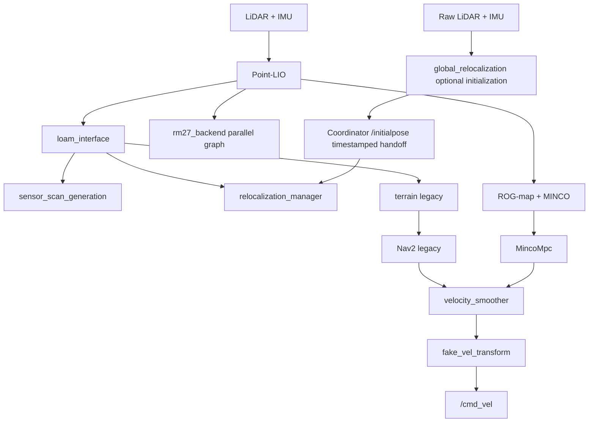

# RM27 Sentry Navigation

[中文](README.md) · [AI development guide](AGENTS.md) · [Repository review](docs/repository_review_2026-11-05.md)

PnX's RoboMaster RM27 navigation workspace, developed from the PolarBear/PB2025 navigation framework. It includes Livox MID360 LiDAR–inertial odometry, prior-map localization, Nav2 navigation, ROG-map + MINCO + MPC, and Gazebo simulation.

**The current source targets Ubuntu 24.04, ROS 2 Jazzy, and Gazebo Harmonic.** The root Dockerfile and CI still use Humble and have not been aligned with the complete current workspace. This guide follows the current launch files, CMake, and YAML; historical documents and validation results must be read in their version context.

## 1. Features and operating modes

Localization and navigation are separate choices: `use_ground_truth_odom` selects the simulation localization source, while `navigation_mode` selects planning and control.

| Scenario | Key settings | Behavior |
| --- | --- | --- |
| Default simulation | `slam:=false use_ground_truth_odom:=true navigation_mode:=legacy` | Gazebo ground-truth localization with the legacy Nav2 stack; useful for navigation and physics checks |
| Point-LIO navigation | `slam:=false use_ground_truth_odom:=false` | Point-LIO with local GICP prior-map alignment; supports `legacy` or `minco` navigation |
| Global initialization | `tools/global_relocalization/navigate.bash` | RMUC2026, MINCO, raw LiDAR/IMU retrieval, stationary confirmation, timestamped pose handoff, then navigation activation |
| Online mapping | `slam:=true use_ground_truth_odom:=false navigation_mode:=legacy` | Point-LIO and slam_toolbox; saves a 2D map and Point-LIO point clouds |
| Independent backend | YAML `rm27_backend.enabled: true` | Atomic Point-LIO scans, keyframes, and a bounded iSAM2 odometry graph; currently runs alongside navigation without publishing TF |

`legacy` uses `GridBased`/ThetaStar and `FollowPath`/Omni PID, with terrain nodes supplying dynamic obstacles. `minco` uses `MincoPlanner`, ROG-map, and `MincoMpc`: planar trajectory planning and SE(2) MPC, rather than full 3D planning. Modes are selected at startup; there is no automatic runtime fallback, and the old `minco_shadow` mode has been removed.

All four deployment YAML files currently enable the backend. The normal localization launch starts it according to that setting in Point-LIO mode and skips it in ground-truth mode. The backend currently receives only a first-pose gauge prior and odometry edges. Map/loop factors have interfaces and tests, but no actual measurement producers are connected. **It does not currently remove frontend drift.** See the [backend guide](src/pnx-localization/backend/README.md) and [backend validation](src/pnx-localization/backend/VALIDATION.md).

## 2. Repository and data flow

| Directory | Contents |
| --- | --- |
| `src/pnx-launch/` | `launch_bringup` launch files, four navigation profiles, maps/PCDs, BTs, and RViz; `pnx_sentry_nav` aggregate package; robot description and `ros_interfaces` |
| `src/pnx-localization/` | Point-LIO, local relocalization manager, global relocalization and action interfaces, odometry adaptation, scan generation, independent backend and atomic-frame interfaces |
| `src/pnx-navigation/` | `minco_planner`, `minco_controller`, `fake_vel_transform`, and the legacy controller submodule |
| `src/pnx-perception/` | ROG-map and terrain nodes; Nav2 plugin and point-cloud-to-scan submodules |
| `src/pnx-stimulation/` | `rm_27_stimulation` Harmonic simulation, `ign_sim_pointcloud_tool` conversion, and `rm27_rendering` helpers |
| `src/livox_ros_driver2/` | Livox driver submodule |
| `src/tools/map_edit/` | ROS map editor package |
| `tools/global_relocalization/` | Isolated builds/launches, map provenance audits, capture, replay, evaluation, and station submaps experiments |
| `tools/mapping/` | Point-LIO export, ERASOR2, CAD point clouds, and alignment checks; excluded from default colcon discovery |
| `tools/stimulation/` | Simulation, initialization, odometry, and backend benchmarks; the existing directory spelling is intentional |
| `docs/` | Architecture, tuning, historical validation, and map provenance |

Directory names are not always ROS package names: `backend` is `rm27_backend`, and `localization_interfaces` is `rm27_localization_interfaces`. Check `package.xml` and `colcon list --base-paths src`.



This diagram describes Point-LIO mode. Ground-truth mode uses `rm27_ground_truth_localizer` for navigation localization inputs; SLAM mode lets slam_toolbox own `map → odom`.

Common topics:

- Simulation sensors: `/livox/lidar`, `/livox/imu`; the converter publishes `/velodyne_points` with `ring/time` fields. GPU scans are instantaneous snapshots and do not establish that real sensor scan deskewing is correct.
- Point-LIO: `/aft_mapped_to_init`, `/cloud_registered`, `/cloud_registered_full`, `/point_lio/diagnostics`.
- Navigation adaptation: `/lidar_odometry`, `/registered_scan`, `/odometry`, `/sensor_scan`.
- Atomic backend input: `/point_lio/backend_frame`, type `rm27_localization_interfaces/msg/FrontendFrame`; backend outputs are `~/odometry`, `~/keyframes`, and `~/diagnostics`.
- Main velocity chain: `/cmd_vel_controller → /cmd_vel_nav2_result → /cmd_vel`. The global initialization coordinator temporarily owns velocity commands and releases control after handoff.

## 3. Environment and build

### 3.1 Source and dependencies

These commands build from the repository root. For an existing workspace, enter its checkout instead; do not copy old `build/` or `install/` artifacts.

```bash
mkdir -p ~/nav_ws
cd ~/nav_ws
git clone --recurse-submodules https://github.com/PnX-HKUSTGZ/sentry_navgation_RM27.git sentry-navigation-RM27
cd sentry-navigation-RM27
git submodule update --init --recursive
source /opt/ros/jazzy/setup.bash
rosdep install --from-paths src --ignore-src --rosdistro jazzy -r -y
```

Before building:

- Install ROS 2 Jazzy and Gazebo Harmonic/`ros_gz` dependencies. Simulation CMake explicitly requires `gz-sim8`, `gz-msgs10`, and `gz-transport13`; it no longer uses Gazebo Classic.
- Initialize the four submodules in [.gitmodules](.gitmodules). Follow the Livox submodule's own instructions for Livox SDK2 and its ROS 2 driver, and ensure colcon discovers the driver package.
- `rm27_backend` needs GTSAM 4.2, TBB, Eigen, and PCL. Point-LIO joint initialization also needs yaml-cpp, nanoflann, and glog. Follow the [backend dependency guide](src/pnx-localization/backend/README.md) for GTSAM. The user-local bootstrap supports Noble amd64 only.
- Both `relocalization_manager` and `global_relocalization` fetch small_gicp through CMake FetchContent, requiring source access on first configuration. The global package pins a commit; the manager currently tracks `master`. A separate manual small_gicp installation is unnecessary for normal builds, but the two dependency versions have not yet been unified.
- Resolve rosdep failures. `-r` continues processing other dependencies; it does not make failed dependencies optional.

```bash
colcon list --base-paths src
CMAKE_BUILD_PARALLEL_LEVEL=2 colcon build --base-paths src \
  --symlink-install --executor sequential \
  --cmake-args -DCMAKE_BUILD_TYPE=Release -DBUILD_TESTING=ON
source install/setup.bash
```

Source ROS and this workspace in each subsequent terminal. `--symlink-install` helps with installed launch/YAML edits; new files, CMake, interfaces, and C++ changes still require rebuilding. For a partial first build, use `--packages-up-to` to include workspace dependencies. Use `--packages-select` when those dependencies have already been built and sourced.

### 3.2 Map resources

Occupancy maps live in `src/pnx-launch/launch_bringup/map/{simulation,reality}/`, and prior clouds in that package's `pcd/` directory. PCDs, occupancy maps, and simulation collisions must share units and coordinate conventions.

| Resource | Current state |
| --- | --- |
| RMUC2026 | Tracked PGM/YAML, PCD, and manifest; global tools also include a frozen PCD/manifest pair |
| RMUL2027 | Tracked PGM/YAML, PCD, and world configuration; standalone simulation and ordinary navigation entries exist |
| RMUC2027 | Tracked official CAD-derived PCD/manifest; no matching navigation world is configured, so `world:=RMUC2027` is unsupported |
| Physical highbay/highbay2 | Occupancy maps exist; the physical PCD directory contains only a placeholder, so supply the actual prior |
| Other historical worlds | Listed in `config/worlds.yaml`; some lack `nav_world` or a matching PCD and cannot be assumed to support combined navigation |

The RMUC2027 PCD failed strict 3D compatibility checks against the existing RMUC2026 scene. Renaming it does not make it a replacement prior. See [CAD provenance and alignment](docs/rmuc2027_cad_pointcloud.md). Generation uses [separate dependencies](tools/mapping/rmuc2027_requirements.txt); ordinary navigation does not require the complete CAD tool environment.

## 4. Running

All commands below assume a built and sourced workspace. Keep the single-robot namespace at its empty default by **omitting `namespace`**. Nonempty namespaces are rejected; the multi-robot entry is outside the current supported setup.

### 4.1 Ordinary simulation

Start with ground-truth localization and legacy navigation:

```bash
ros2 launch rm_27_stimulation sim_with_nav.launch.py \
  world:=RMUC2026 navigation_mode:=legacy \
  use_ground_truth_odom:=true gui:=false use_rviz:=true
```

Explicitly enable Point-LIO when checking the estimation pipeline, for example with MINCO:

```bash
ros2 launch rm_27_stimulation sim_with_nav.launch.py \
  world:=RMUC2026 navigation_mode:=minco \
  use_ground_truth_odom:=false gui:=false use_rviz:=true
```

If Gazebo and the robot are already running, start navigation alone:

```bash
ros2 launch launch_bringup rm_navigation_simulation_launch.py \
  world:=RMUC2026 navigation_mode:=minco use_ground_truth_odom:=false
```

The ordinary GICP manager performs local alignment only. Supply a sufficiently close initial pose through YAML `init_pose` or RViz **2D Pose Estimate**. After localization is ready, send a **Nav2 Goal**. Successful ground-truth navigation does not validate Point-LIO accuracy.

### 4.2 Global relocalization followed by navigation

```bash
bash tools/global_relocalization/build.bash
bash tools/global_relocalization/navigate.bash
```

The wrapper sources an isolated overlay at `tools/global_relocalization/.build/ros/install`, defaults to `ROS_DOMAIN_ID=87` and a separate `GZ_PARTITION`, and configures large-cloud DDS transport. Build the base navigation dependencies first. `GLOBAL_RELOCALIZATION_ROS_SETUP` and `GLOBAL_RELOCALIZATION_DEPENDENCY_INSTALL` select a custom ROS setup or dependency overlay; see [environment.bash](tools/global_relocalization/environment.bash).

Use RViz **2D Pose Estimate** to select the spawn location and heading. This selection creates the simulated robot and is not directly accepted as the localization result. The system performs raw LiDAR/IMU retrieval, rotation preparation, competition start, and three fresh stationary confirmations. It uses the original timestamp to hand off `map → odom`, restores the heading, and activates navigation. Then send a **Nav2 Goal**.

This integration requires RMUC2026, `slam:=false`, and MINCO. The competition profile searches the `x<0` half-field; choose an open location there for initial use. See [integration and sensor/gimbal limitations](docs/simulation_global_navigation.md). Append `stationary_relocalization:=false` to disable refinement after initialization. Ordinary launches leave the global workflow disabled.

### 4.3 Mapping

```bash
ros2 launch rm_27_stimulation sim_with_nav.launch.py \
  world:=RMUC2026 slam:=true navigation_mode:=legacy \
  use_ground_truth_odom:=false gui:=false use_rviz:=true
```

SLAM supports legacy navigation only and is incompatible with ground-truth odometry. slam_toolbox dynamically publishes `map → odom`; this is not a static transform.

Save the occupancy map from another sourced terminal:

```bash
ros2 run nav2_map_server map_saver_cli -f /tmp/my_map \
  --ros-args -p use_sim_time:=true
```

Mapping enables Point-LIO's `pcd_save.pcd_save_en`. On exit, accumulated points are saved under the source tree at `src/pnx-localization/point_lio/PCD/scans.pcd`, using the compile-time `ROOT_DIR`. Check save conditions, source-path writability, and shutdown logs separately: saving the occupancy map does not establish that a PCD was saved. More complete export, dynamic-object removal, and provenance tools live in `tools/mapping/` and `tools/global_relocalization/` and are separate from this minimal workflow.

### 4.4 Physical robot

Configure [MID360 networking and compensation](src/pnx-launch/launch_bringup/config/reality/mid360_user_config.json), extrinsics, robot TF, occupancy map, and prior cloud first. This example explicitly disables the bundled robot description and assumes the complete robot system already publishes TF:

```bash
ros2 launch launch_bringup rm_navigation_reality_launch.py \
  world:=highbay2 navigation_mode:=minco slam:=false \
  prior_pcd_file:=/absolute/path/to/highbay2.pcd \
  use_robot_state_pub:=false
```

Physical mapping:

```bash
ros2 launch launch_bringup rm_navigation_reality_launch.py \
  slam:=true navigation_mode:=legacy use_robot_state_pub:=false
```

The source default for `use_robot_state_pub` is actually `true`. Calibrate the fixed `sentry_robot_description` model before using it. The physical example description, articulated simulation, and driver compensation have separate settings; the old README's universal mounting offset/roll does not apply. The current driver JSON specifies `roll: 45.0`, which is not evidence of completed hardware calibration. Avoid compensating the same rotation twice in the driver and TF. The simulated LiDAR defaults to `[0, 0.126, 0.130] m` and roll `-30°` relative to `gimbal_yaw`; do not copy that configuration to hardware without calibration.

## 5. Common launch arguments

Check each entry's `--show-args`; top-level launches do not forward every internal parameter:

```bash
ros2 launch rm_27_stimulation sim_with_nav.launch.py --show-args
ros2 launch launch_bringup rm_navigation_reality_launch.py --show-args
```

| Argument | Current default / constraint |
| --- | --- |
| `world` | Simulation: `RMUC2026`; hardware: `highbay` |
| `nav_world` | Combined simulation: `auto`, resolved from `config/worlds.yaml` |
| `slam` | `false`; requires legacy and Point-LIO when enabled |
| `navigation_mode` | `legacy` or `minco`; default `legacy` |
| `use_ground_truth_odom` | Simulation default `true`; explicitly set `false` for Point-LIO validation |
| `namespace` | Empty default; omit it. Nonempty values are rejected |
| `use_sim_time` | Simulation `true`; hardware `false` |
| `params_file` | Selects simulation/reality `nav2_params.yaml` or `minco_params.yaml` by mode; custom MINCO files must be complete profiles |
| `map` / `prior_pcd_file` | Navigation entries derive defaults from world; pass custom paths to those entries. The combined simulation entry does not provide generic forwarding arguments with these names |
| `gui` / `use_rviz` | Combined simulation defaults `false` / `true`; set both to `false` without a display |
| `use_robot_state_pub` | Physical entry only; source default `true`; explicitly disable when TF is supplied elsewhere |
| `enable_legacy_terrain` | `auto`: on for legacy, off for MINCO |
| `autostart` / `use_composition` / `use_respawn` | `true` / `false` / `false`; the global workflow delays activation |
| `global_relocalization` | Simulation default `false`; requires matching PCD, manifest, global package, and coordinator |
| `stationary_relocalization` | Default `true`; controls refinement after global initialization |

The four navigation profiles are under [config](src/pnx-launch/launch_bringup/config). Launch also applies world and Point-LIO input profiles and generates temporary YAML. Inspect the parameters actually passed to nodes when debugging.

## 6. Development, validation, and limitations

Read [AGENTS.md](AGENTS.md) first. Example package checks after building with testing enabled:

```bash
colcon test --packages-select point_lio rm27_backend rog_map \
  minco_planner minco_controller fake_vel_transform \
  loam_interface sensor_scan_generation relocalization_manager \
  launch_bringup rm_27_stimulation rm27_rendering \
  --event-handlers console_direct+
colcon test-result --verbose
```

The global pipeline has a separate check entry:

```bash
bash tools/global_relocalization/check.bash
```

This builds the global packages and runs CTest, tool pytest, and station submaps contract checks; it is more than lint. Simulation/backend performance entries are in `tools/stimulation/benchmark_*.py`. Use a separate ROS domain and output directory, and record maps, parameters, localization mode, simulation time, and wall time.

The documentation review on 2026-11-05 reran **169 passing** tool/station submaps tests. The explicitly selected launch, handoff, and rendering tests produced **91 passes and 17 failures**. Optional CAD tests were not completed because the system Python lacks `shapely`. The 17 failures include configuration assertions and collision-structure differences and must not all be dismissed as harmless old tests. This change updates documentation only; it does not tune motion parameters or weaken assertions. See the [review record](docs/repository_review_2026-11-05.md) for commands, impact, and priorities. No fresh complete build, Gazebo navigation acceptance run, or physical-robot test was performed for this review.

Additional limitations:

- Simulation MINCO currently sets `projection.vehicle_height` to `0.040 m`, while the model declares `folded_vehicle_height=0.240 m`. Clearance tests fail as well; full-vehicle low-ceiling traversal is not established by this configuration.
- Synthetic/simulation results for the backend and joint initialization do not replace hardware validation. A coordinate-consistency risk remains documented for fixed nonzero LiDAR–IMU extrinsics.
- `tools/reality/start_nav.bash` and `tools/stimulation/start_nav_stimulation.bash` contain machine-specific paths and broad process cleanup. Prefer the direct launch commands above.
- The root Dockerfile clones source from a remote repository and retains Humble. Old upstream images do not represent this checkout, and CI does not cover the current complete launch, global relocalization, and backend pipeline.

## 7. Further reading and licenses

- [Localization index](src/pnx-localization/README.md), [local GICP manager](src/pnx-localization/relocalization_manager/README.md), and [atomic-frame interface](src/pnx-localization/localization_interfaces/README.md).
- [ROG/MINCO architecture](docs/rog_minco_navigation_architecture.md) and [tuning/debugging](docs/rog_minco_tuning_debug_guide.md): these include historical sections; current source controls modes and parameters.
- [Global localization algorithms](docs/global_relocalization.md), [integration validation](docs/global_relocalization_merge_20261102.md), and [station submaps experiments](tools/global_relocalization/station_submaps/README.md).
- [Simulation package](src/pnx-stimulation/rm_27_stimulation/README.md), [RMUL2027 world](docs/rmul2027_simulation_world.md), and [gimbal controls](docs/simulation_gimbal_controls.md).

The root [LICENSE](LICENSE) is Apache-2.0; components and datasets retain their own licenses. In particular, Point-LIO's joint initialization core has [GPL-2.0-only provenance and licensing](src/pnx-localization/point_lio/third_party/zlio_startup/README.md), and official CAD-derived data has separate attribution and usage terms. Do not label every file in the workspace Apache-2.0. Thanks to PolarBear navigation, Nav2, Point-LIO, ROG-map, small_gicp, GTSAM, ZLIO, and related upstream projects.
