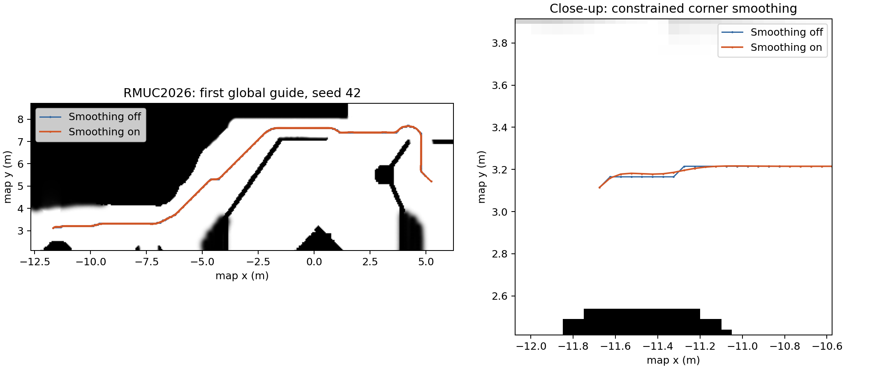

# 2026-10-28 全局路径平滑优化与验证

已在默认 SMAC 全局搜索后和 MINCO 局部引导生成后加入约束平滑，并修复加密路径段未参与转弯限速的问题。RMUC2026 真值定位仿真中，两个种子的开关对照全部完成；首次全局路径最大相邻转角由约 45–47° 降为 11–21°。这些结果证明几何引导明显平滑，不等于已经证明实车运动波动全面下降。

## 修改内容

- SMAC 输出转换为世界坐标、设置精确目标后，使用二阶差分和原路径吸引联合优化；固定端点、保留点数，每个点相对本次输入最多偏移 0.25 m。
- 局部路径在稀疏化、转弯加密后再次使用同一平滑器，防止引导重新变成折线。反向折返现在也会被识别为转弯。
- 每次移动检查两条相邻边。静态地图使用逐格遍历，包括穿过栅格顶点时的两侧格；不只检查顶点。膨胀代价的峰值和平均值相对原始边限制，迭代不能累计放宽。
- 全局平滑复用 SMAC 的动态障碍证据和 ESDF 缓存策略；局部平滑检查实测 yaw 下的完整 footprint，并对新增边加半格侧向采样余量。未知区域或不能通过检查的局部调整保持原路径。最终 MINCO 轨迹的碰撞、净空和动力学校验继续执行。
- 转弯限速改用顶点前后各 0.3 m 的路径方向，移除原来的“任一邻段 ≤0.2 m 就不限速”条件。保留现有前后向速度传播和时间分配。
- 默认最多 60 轮，迭代预算 10 ms。预算为协作式检查，正在执行的边检查和末次复核可能超时；取消时恢复输入路径。配置位于两套 `minco_params.yaml` 的 `MincoPlanner.path_smoothing`，更改需重新配置／重启 planner。

备用 A* 和探索边界搜索的全局离散输出未接入全局后处理，但其局部 MINCO 引导会经过平滑。几何引导本身仍是离散路径，连续 P/V/A 由 MINCO 多项式与边界条件提供。

## 回归测试

规划器 12 个 CTest 目标、147 个 GTest 用例通过；批测工具 16 个 Python 用例通过。新增覆盖锯齿消除、端点及偏移保持、关闭平滑、静态障碍／未知／高代价带绕行、动态 footprint、格角相交、取消回退、无效输入，以及转弯限速对点密度的一致性。

规则锯齿用例的二阶差分平方和降到原来的 **0.02647%**。这只反映该合成用例，不能替代地图和运动验证。首轮动态拐角测试发现仅沿中心线采样会漏掉很短的切角，加入半格侧向检查后通过。旧的起点测试也改为区分安全探测位置与实际引导点，并继续要求实际引导不退回旧起点。

构建时有现有第三方库警告，无编译错误。安装版单独运行回归测试通过，避免测试误用工作区中的旧安装库。

[构建、测试日志及 XML](../tools/navigation_benchmark/results/20261028_smoothing/validation/)

## 同版本开关对照

五目标序列：`[5.231,5.213] → [-3.535,6.374] → [-4.56,-2.03] → [-3.94,-4.89] → [-4.56,-2.03]`。

采用 GT 定位，种子 42、43；每次重启 Gazebo，独立 ROS domain／Gazebo partition。每组 planner 运行参数仅 `path_smoothing.enabled` 不同，已记录核心程序哈希、DDS 配置相同。新的转弯限速逻辑在两侧都启用，所以本对照隔离的是平滑开关，不能单独量化限速修复的收益。

| 种子 | 平滑 | 成功目标 | 路线累计时间 | ≥1 s 中途停车候选 | 最大真值终点误差 | 已发布正常参考轨迹峰值 jerk |
|---|---|---:|---:|---:|---:|---:|
| 42 | 关闭 | 5/5 | 54.506 s | 0 | 0.159 m | 115.853 m/s³ |
| 42 | 开启 | 5/5 | 53.614 s | 0 | 0.175 m | 100.038 m/s³ |
| 43 | 关闭 | 5/5 | 55.165 s | 0 | 0.178 m | 114.023 m/s³ |
| 43 | 开启 | 5/5 | 53.174 s | 0 | 0.168 m | 94.942 m/s³ |

四次路线共 **20/20** 目标完成，各目标均收到 MINCO 轨迹和非零 MPC 输出，真值终点门限 0.35 m 全部通过。停车计数排除开始 2 秒及距目标 0.35 m 内的停车，不能把 0 个候选解释为整个运行从未降速。

每段首次匹配目标的全局引导，最大相邻转角从约 45–47° 降到 11–21°，归一化折弯指标下降约 83–97%。该指标为 `Σ(转角² / 相邻边平均长度) / 总长度`，便于在相同地图分辨率下比较离散路径。原始点列全部保留，不以显示插值替代算法结果。

参考 jerk 的路线峰值下降，但各路段速度幅值变化率 RMS 和 jerk 并非一致下降。参考 jerk 来自 MINCO 消息，不是实测底盘 jerk；速度变化率来自约 20 Hz 真值速度幅值的差分。两种子样本不足以证明运动指标普遍改善或运行时间差异具有统计意义。本轮未进行实车、Point-LIO 完整定位链、其他地图和长期负载复测。



- [完整指标与原始运行目录索引](../tools/navigation_benchmark/results/20261028_smoothing/comparison.json)
- [同版本／运行参数核对](../tools/navigation_benchmark/results/20261028_smoothing/validation/comparison_provenance.json)
- `disabled_seed42` 为安装最终侧向检查之前的预跑，成功 5/5；保留原始记录，但不纳入上表。同版本对照使用 `disabled_final_seed42`。

## 复现

```bash
source /opt/ros/jazzy/setup.bash
source install/local_setup.bash
CMAKE_BUILD_PARALLEL_LEVEL=4 colcon build --base-paths src \
  --packages-select minco_planner --executor sequential --symlink-install \
  --cmake-args -DBUILD_TESTING=ON
source install/local_setup.bash
ctest --test-dir build/minco_planner --output-on-failure
python3 -m unittest discover -s tools/navigation_benchmark -p 'test_*.py'

# 选择空闲 domain 和新的输出目录；enabled.yaml 换成 disabled.yaml 做对照。
python3 tools/navigation_benchmark/batch.py --domain 96 --repeats 1 --seed 42 \
  --output /tmp/rm27-smoothing-enabled \
  --params tools/navigation_benchmark/results/20261028_smoothing/enabled.yaml \
  --goals '[[5.231,5.213],[-3.535,6.374],[-4.56,-2.03],[-3.94,-4.89],[-4.56,-2.03]]'
```

`smoothing_report.py ROOT... --output comparison.json` 汇总全局点列、实际速度变化和参考动力学；`plot_smoothing.py` 用两份 `run_01.json` 与地图 YAML 重画路径对照。两套生产参数均默认启用平滑，可将 `path_smoothing.enabled` 设为 `false` 并重启 planner 回退到原几何引导。
