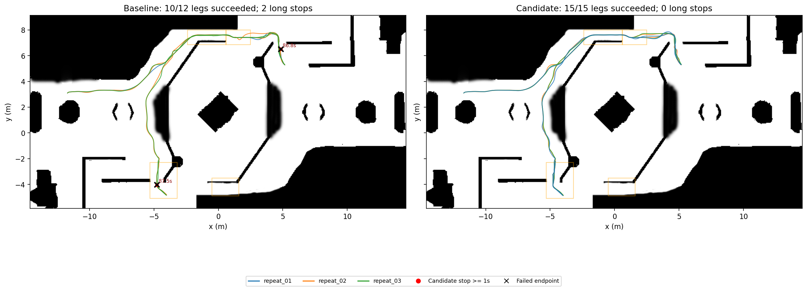

后续更新：Point-LIO 恢复、完整链修复和多种子／南洞补测见 [后续报告](navigation_benchmark_followup_20261028.md)。下文保留首轮历史结果，不代表当前完整链状态。

本轮采用的仿真调参是 **MINCO 近障碍目标速度从 1.0 降至 0.8 m/s**，开阔地和 MPC 上限保持 1.5 m/s。相同场景下，安全基线 3 次导航启动中 1 次完成全程；选定参数 3 次有效导航均完成全部 15 段，未检测到途中停车候选。另有一次规划器启动失败，完整保留，不能将总启动成功率写成 100%。这是小样本仿真结果，不是任意场景或完整定位链已通过的结论。

代码工作保留了会话开始时的未提交修改。本轮只修改仿真 YAML 和新增批测工具，没有改动 ROGMap、MINCO、MPC 的运行逻辑，没有扩大碰撞容差、净空容差、地图/里程计超时或未知区域放行范围。

所有材料位于 [results/20261028](../tools/navigation_benchmark/results/20261028/)。复跑方法见 [批测说明](../tools/navigation_benchmark/README.md)，机器可读统计见 [comparison.json](../tools/navigation_benchmark/results/20261028/comparison.json)，逐项参数差异见 [configuration_changes.json](../tools/navigation_benchmark/results/20261028/configuration_changes.json)。

开始时先检查了旧日志。历史“零短停”文档对应的原始 CSV 已不在当前机器，不能重算；已有短目标到达记录也缺少完整停车时序。旧物理返程位置轨迹能筛出约 3.77 秒低速，但使用墙钟、缺少准确 action 起点和安全原因，未混入本轮统计。

原安装程序与新源码不一致：规划器库仍为 10 月 10 日构建。原安装程序初测首段出现 1.26 秒、3.48 秒停车，返程停顿约 86.64 秒后超时。该数据保存在 [installed_old_smoke](../tools/navigation_benchmark/results/20261028/installed_old_smoke/)，只用于诊断，不能与新构建直接比较并归因于调参。随后从当前源码构建了 ROGMap、MINCO、MPC 及相关接口。正式 GT 对照的三套核心库 SHA256 一致。

在正式参数对照前修正了两个明确的仿真配置问题：

| 配置 | 会话开始值 | 最终值及依据 |
|---|---|---|
| ROG 投影 `vehicle_height` | 0.050 m | 0.240 m，与仿真碰撞模型一致，恢复实际车高净空检查 |
| 自滤波包络 | `base_link`、`gimbal_roll` 两个盒子 | 当前折叠仿真模型不存在 `gimbal_roll`，保留原 `base_link` 的 0.62×0.62×0.24 m 包络；不绕过 TF 失败保护 |
| MINCO `obstacle_max_velocity` | 1.0 m/s | **0.8 m/s**，本轮最终采用的性能调参 |
| 完整链点云话题 | `/cloud_registered_full` | `/cloud_registered`；保留原 `camera_init` 与 `/aft_mapped_to_init`，当前已安装 Point-LIO 不发布前一话题 |

前两个修正之后的 `safe_baseline.yaml` 才是正式安全基线。新构建发现缺失滤波 TF 时停止了该次试验，原记录保存在 `missing_gimbal_frame_failure`。自滤波更改没有清空环境障碍或缩小车身碰撞轮廓。仿真配置与物理 URDF 的车高、滤波坐标系一致性现在有独立回归检查。实车配置未改。

正式对照使用 RMUC2026、Bullet Featherstone、固定种子 42、固定出生点 `(-11.7, 3.1, 0.08)`，每次重复重启仿真。目标依次为 `(5.231,5.213)`、`(-3.535,6.374)`、`(-4.56,-2.03)`、`(-3.94,-4.89)`、`(-4.56,-2.03)`。使用独立 ROS domain 92、每次独立 Gazebo partition；等待导航生命周期激活并预热 3 秒后发 action。单段上限 90 仿真秒，失败后停止该路线，后续未执行路段不记为成功或零停车。固定种子不能消除 ROS 调度和观测到达顺序的差异。

真值仅由独立观察器采样；GT 模式下在线导航本身明确使用真值定位，不能称为全传感器测试。运行时检查 planner/controller 插件类型、生命周期和话题发布者，所有正式 GT 路段均收到 MINCO 轨迹和非零 MPC 输出。保留完整参数转储、库/源文件哈希、启动命令、日志、逐段轨迹和失败结果；样本间隔最大约 0.06 秒。

停车主口径为真值水平速度 ≤0.05 m/s、连续 ≥1 秒，长停 ≥5 秒；另做 ≥0.1 秒的短停敏感性统计。排除 action 开始后 2 秒及距目标 ≤0.35 m 的停车，超过宽限仍持续停车的部分计入。采样间断超过 0.3 秒不连接。坡道按区域或车体 roll/pitch 判定，洞口按已记录路线附近的矩形标记；区域可重叠，计数不能相加。北侧洞口有实际路径覆盖，南侧中央洞口没有被这组固定路线穿越，不据此声称南洞通过。

**BLOCK 只证明触发保护，不证明停车必要，也不证明它是误停。** 工具仅在明确安全理由覆盖至少 80% 停车时间时排除该事件。本轮 GT 中两个基线事件都有净空/车身检查拒绝记录，但缺少足够证据区分真实障碍与投影误判，列为待判定候选：已确认非预期次数无法可靠确定，可能范围为 0–2；没有将它们直接当作已确认非预期停车。起终点和无效启动试验不混入下表，明确必要安全停车的额外排除数为 0。

| 同场景配置 | 完整路线/有效导航启动 | 成功路段/实际尝试 | ≥1 秒停车候选 | ≥5 秒长停 | 坡道停车候选 | 洞口停车候选 | ≥0.1 秒候选 |
|---|---:|---:|---:|---:|---:|---:|---:|
| 安全基线：开阔地 1.5、近障碍 1.0 | 1/3 | 10/12 | 2 | 2 | 2 | 0 | 3 |
| 试验：规划器/MPC 上限 1.2、近障碍 0.8 | 2/3 | 11/12 | 4 | 1 | 4 | 0 | 7 |
| **采用：开阔地 1.5、近障碍 0.8** | **3/3** | **15/15** | **0** | **0** | **0** | **0** | **0** |

选定配置由 `obstacle_speed/repeat_02`、`repeat_03` 和 `obstacle_speed_confirmation/repeat_01` 组成。`obstacle_speed/repeat_01` 在导航前报 `StaticObstacleClearanceQuery static-source geometry does not match the base query`，属于启动失败；因此总启动尝试为 4 次、完成路线 3 次。日志支持地图初始化顺序存在竞态，但未打印双方几何，尚未完全证实根因。没有删除该次失败或关闭静态几何一致性检查。

基线两个长停分别位于约 `(4.833,6.518)` 的平台侧坡和 `(-4.778,-4.032)` 的南侧上坡，持续 86.82 秒、87.54 秒。首个案例详见 [基线返程记录](../tools/navigation_benchmark/results/20261028/safe_baseline/repeat_01/run_02.json)，第二个见 [基线上坡记录](../tools/navigation_benchmark/results/20261028/safe_baseline/repeat_02/run_05.json)。碰撞网格的点查询和输入哈希保存在 [geometry_evidence.json](../tools/navigation_benchmark/results/20261028/geometry_evidence.json)；世界坐标高度与日志中的 odom 高度不能直接相减，点射线也不能证明整车扫掠净空，故未据此关闭保护。

选定配置三次完整路线耗时为 **48.54、47.82、49.74 秒**，路程约 **47.28、47.08、47.56 米**；基线唯一完整成功为 45.48 秒、47.15 米。仅比较这些成功路线，平均耗时增加约 7%；这是成功样本比较，不能忽略基线另外两次失败。全程降速方案的一次返程绕行 35.49 米，整条路线耗时 81 秒，且仍有一次长停失败，所以没有采用。北洞区域有样本的路段数分别为基线 5、选定配置 6，避免把未经过洞口的零停车误当作通过。

完整定位链另行测试，未通过，不与 GT 合并计算成功率：

| 诊断配置 | 实际结果 |
|---|---|
| 标准完整链入口 | 默认 RMUC2026 PCD 缺失，启动失败；`full_chain_baseline` 保留日志 |
| 指定现有同场地先验，原输入话题 | Point-LIO、GICP 初始化正常，但 `/cloud_registered_full` 无发布者，ROG 无点云；`full_chain_existing_prior` 保留失败 |
| 改用 loam 的 odom 点云/里程计 | 实际生成轨迹和非零 MPC 指令，但 map↔odom 约 30° 倾斜导致先验地面保护；首段 60 秒未完成，未采用此坐标系配置 |
| **保留 camera_init，仅改为实际发布的点云话题，并使用近障碍 0.8** | 首段实际行驶约 18.38 米，收到 162 条轨迹、847 条非零 MPC 指令；60 秒超时，距目标仍约 2.87 米；记录 2 次 ≥1 秒停车候选、20 次 ≥0.1 秒候选、0 次 ≥5 秒长停，其中主口径 1 次位于北洞区域 |

最后一次完整链的运行证据见 [runtime.json](../tools/navigation_benchmark/results/20261028/full_chain_camera_input/repeat_01/runtime.json) 和 [run_01.json](../tools/navigation_benchmark/results/20261028/full_chain_camera_input/repeat_01/run_01.json)。实际输入头确认 `/cloud_registered` 与 `/aft_mapped_to_init` 同属 `camera_init`，见 [输入坐标系审计](../tools/navigation_benchmark/results/20261028/validation/pointlio_input_headers.json)。这条链没有真值定位节点；真值只供独立评估。

完整链还存在明确时效问题：本次 action 日志有 19 条 `ODOMETRY_RX_STALE`、28 条 `SYNC_TOLERANCE`，例如配对差 0.330 秒超过 0.100 秒。保留 camera_init 消除了约 30° 的系统性坐标倾斜，但仍有 5 条小幅倾角超限告警（例如 pitch=-0.012054 rad，门限 0.01）。没有放宽 MPC 0.25 秒里程计时效、点云配对 0.10 秒、完整链 0.40 净空观测比例或 0.01 rad 水平门限。两个停车候选伴随时效保护，不能凭此认定为非预期误停；该实验是链路诊断，尚无完整链性能验收结论。

最新 TF 与真值的 XY 差值中位数约 0.056 米、P95 约 0.202 米、最大约 0.431 米；由于时间未精确对齐，这包含 TF 延迟，**不是同步定位精度指标**。先验来自仓库内真值辅助的离线地图准备，manifest 声明 map/world 一致；独立实验将先验变换设为零，未把此地图说成 Point-LIO 建图产物，也没有将真值位姿回灌定位。

验证记录见 [validation](../tools/navigation_benchmark/results/20261028/validation/)：6 个相关包构建完成；ROGMap、MINCO、MPC 的 colcon 测试统计分别为 147、147、55 项，均无失败；新批测/模型一致性测试 8 项通过，Point-LIO profile 启动配置测试通过。`fake_vel_transform` 的功能测试通过，但原有格式检查仍报换行差异，没有为清零检查而改写用户代码。

还需解决的事项是：静态地图与规划器初始化的偶发失败；完整链里程计时效、点云配对和小幅坐标倾斜；坡道保护事件的真实障碍/误判区分；更多种子、路线、传感器负载及南侧中央洞口覆盖。当前 GT 成果只覆盖固定路线的三次有效重复，不外推为系统性零停车保证。全部失败、无效启动和未采用参数均留存；本轮启动的进程已经清理，原先存在的用户仿真未终止。
