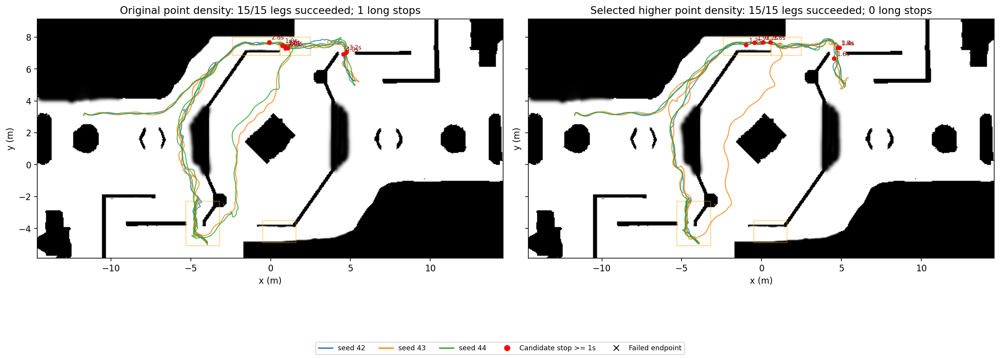

# 2026-10-28 导航后续修复与批测报告

本文续接[上一轮报告](navigation_benchmark_20261028.md)。本轮采用的仿真配置仅在 RMUC2026 world profile 将 Point-LIO `point_filter_num` 从 8 改为 1、`filter_size_surf` 从 0.2 改为 0.1 m；沿用 6DoF GICP、近障碍速度 0.8 m/s。固定五目标三种子与南洞三种子高密度完整链均完成，固定路线 ≥1 秒停车候选仍为 7 次，累计时间减少约 17.9%、长停从 1 次降为 0，洞口候选有所增加；这些是小样本观测，不证明因果或实车效果。高密度设置仅影响 RMUC2026 世界的 Point-LIO 配置，不改变 GT 在线定位，也不改其他世界或实车默认。

4DoF 实验未采用，其生产选项已撤回，保留配准姿态诊断日志和[实验恢复补丁](../tools/navigation_benchmark/results/20261028_followup/validation/4d_experiment_patches.md)。最终安装版又独立完成五目标验证：5/5 段，≥1 秒停车候选 0，≥5 秒长停 0；未把这次额外验证混入前三种子的参数对照。

原始数据均保存在 [follow-up 目录](../tools/navigation_benchmark/results/20261028_followup/)，可复算的逐组、逐段结果及程序/DDS 哈希见[完整矩阵](../tools/navigation_benchmark/results/20261028_followup/followup_summary.json)，复跑说明见[批测 README](../tools/navigation_benchmark/README.md)。每次独立重启，失败、超时和未采用配置均保留。GT 模式在线使用 Gazebo 真值定位；完整链使用 Point-LIO、loam_interface 和 GICP，真值仅由独立观察器用于评估。拓扑验证不代表定位精度验证。

## 已确认问题与修改

- 经授权恢复了先前被删除的 Point-LIO 工作文件，恢复前保存的删除差异见[补丁](../tools/navigation_benchmark/results/20261028_followup/validation/pointlio_deletion_before_restore.patch)。仿真 GPU 雷达为瞬时扫描，原 Point-LIO 对没有点内时间的扫描按旋转模型补时间；现有显式 `instantaneous_scan` 模式保留同帧零偏移，并处理空帧和 ring 越界。默认值保持关闭，仿真配置显式使用。另修正点缓存仅 `reserve` 后按下标写入导致的越界，以及 EKF 大批观测分支误用 `HᵀH × R` 的噪声权重，改为与另一分支一致的 `HᵀH / R`（增益项同样修正）；对应构建与回归日志保留在 validation 目录。
- Point-LIO 的 `camera_init` 在当前配置已重力对齐，loam_interface 再叠加雷达安装倾角会重复旋转坐标；新增明确的重力对齐输入模式，保留原未对齐输入分支。当前完整链沿用 `camera_init` 点云与对应里程计。实测中仍会出现非水平 TF，不能据此认定全部坐标或定位问题已经解决。
- 默认 RMUC2026 完整链此前缺少包内 PCD，现提供与[原离线先验](../tools/global_relocalization/assets/RMUC2026/map.pcd)同字节的[默认 PCD](../src/pb2025_nav_bringup/pcd/simulation/RMUC2026.pcd)及[采集 manifest](../src/pb2025_nav_bringup/pcd/simulation/RMUC2026_manifest.json)。该地图在离线准备时使用 Gazebo 真值辅助，已经处于 world/map 坐标，MINCO 的 RMUC2026 世界配置使用零先验变换且不再叠加雷达安装偏移；这不是在线真值定位，也不是 Point-LIO 在线建图成果。
- 静态净空构造此前可能在静态层首张地图到达前读取默认尺寸。现在等待真实 StaticLayer 就绪，使用 3 秒 wall-clock 上限，并按 costmap 锁序构造一致快照；未就绪和几何不一致仍失败，异常包含双方几何。独立 ROS 测试覆盖延迟到图、无图超时以及静态障碍与周边硬化。**旧失败还先出现 map_server 生命周期服务响应超时，原日志没有双方几何；等待静态层不能恢复未激活的地图服务，也不能证明旧次失败的唯一根因。后续启动未重现该 map_server 服务响应超时，因此其上游原因仍未确定。** 详见[启动诊断](../tools/navigation_benchmark/results/20261028_followup/static_map_startup_diagnosis.md)。
- 曾实验 4DoF 重力约束 GICP；最终未采用，相关生产选项和测试已撤回，保留 RPY 诊断日志。实验实现与测试可通过[归档补丁](../tools/navigation_benchmark/results/20261028_followup/validation/4d_experiment_patches.md)恢复并重新构建；历史试验 profile 单独使用不能重新启用该功能。

## 主要试验参数差异

| 配置 | 静态场景与定位 | 近障碍目标速度 | 用途 |
|---|---|---:|---|
| GT 安全基线 | RMUC2026；在线真值定位 | 1.0 m/s | 固定路线和南洞 GT 对照 |
| GT 选定 | RMUC2026；在线真值定位 | 0.8 m/s | GT 三种子对照 |
| 完整链旧默认 | Point-LIO 点采样 8、体素 0.2 m；6DoF GICP | 0.8 m/s | 完整链对照 |
| 完整链采用 | RMUC2026 Point-LIO 点采样 1、体素 0.1 m；6DoF GICP | 0.8 m/s | RMUC 专用 world profile |
| 4DoF gravity / gravity_slow（归档） | 实验版重力约束配准 | 分别 0.8 / 0.6 m/s | 对照实验，未采用 |
| 6DoF slow | 4DoF 关闭 | 0.6 m/s | 完整链慢速对照 |
| IMU input | Point-LIO IMU 输入模式开启 | 见该次参数快照 | 首段超时，未采用 |

上表只列决定组别的主要差异，不表示其余参数或程序二进制完全一致；逐次参数快照及哈希见各次 manifest。GT 模式不启动 Point-LIO，该 RMUC 参数对 GT 定位不生效。

## 点云传输与计数口径

输入审计中，复现完整链的 `/cloud_registered` 到达间隔中位数约 0.299 秒、最大约 2.28 秒；观察器接收时间和最近里程计匹配只说明观察到的可用性，不能直接等同规划器内部配对。详见[输入审计](../tools/navigation_benchmark/results/20261028_followup/validation/reproduce_input_summary.json)。

独立 DDS 大点云探针对每种配置分别以 1、2、3 MiB 载荷各发送 50 帧（并非同一载荷重复三次）：默认接收 46/32/37 帧；64 MB 共享内存为 50/50/50；512 MB 共享内存为 25/33/20；64 MB 共享内存加 UDP 为 50/50/50。结果见[探针汇总](../tools/navigation_benchmark/results/20261028_followup/dds_cloud_transport/summary.json)。这是该机器、该负载和该测试的结果，不证明任意节点、负载或网络下不丢帧；导航批测在 manifest 记录 DDS profile 和哈希。

停车使用真值水平速度 ≤0.05 m/s、连续 ≥1 秒，长停 ≥5 秒；另统计 ≥0.1 秒敏感性候选。排除起步宽限、目标附近和有足够明确安全理由的区间，采样断续超过 0.3 秒不连接。坡道由区域或车体姿态标记，洞口由近似区域标记，类别可重叠。**候选是待判定事件，不是已确认误停；BLOCK 或安全拒绝只能证明保护触发，不能单独证明停车必要或误判。** 动作内告警数取观察器采集的 rosout，受记录覆盖影响；完整启动日志数另在矩阵中列出。早期记录没有真值终点 gate 时保留空值，末次真值样本距离不替代该 gate。

对已记录的 TF 时间戳，用前后真值线性插值对齐，要求包围采样间隔 ≤0.3 秒；这是近似同步比较，不是经过标定的绝对定位精度。6DoF transport 42、default 43/44 的 XY 差值中位数分别约 0.018/0.030/0.025 m，P95 分别约 0.086/0.161/0.066 m；4DoF slow 42/43/44 中位数分别约 0.090/0.024/0.035 m，P95 约 0.121/0.187/0.169 m。覆盖与分位数见各次 `input_audit_summary.json`，该指标不包含严格同步和插值误差界。高密南洞三个种子的 XY 差值 P95 为 0.032/0.033/0.027 m；Z 差值 P95 为 0.112/0.095/0.069 m，不能仅凭平面误差小而忽略高度误差。

## 已结束试验

表中停车列依次为 ≥1 秒候选、≥5 秒、坡道、洞口及 ≥0.1 秒敏感性候选。时间和距离是已采样路段之和；失败路线只包括已尝试部分。动作内告警顺序为里程计接收过期、时间戳过期、点云同步超限、非水平 TF。

| 配置与种子 | 路线 / 段 | 停车候选 | 时间 / 路径 | 动作内告警 |
|---|---|---|---|---|
| GT 基线 42 | 1/1；5/5 | 1 / 0 / 1 / 0 / 2 | 51.4 s / 47.9 m | 0 / 0 / 0 / 0 |
| GT 选定 42、43、44 | 3/3；15/15 | 0 / 0 / 0 / 0 / 1 | 47.6–48.1 s / 47.2–47.5 m，每路线 | 均 0 / 0 / 0 / 0 |
| 南洞 GT 基线 42、43、44 | 3/3；9/9 | 0 / 0 / 0 / 0 / 2 | 20.7–21.4 s / 21.3–21.6 m，每路线 | 均 0 / 0 / 0 / 0 |
| 南洞 GT 选定 42、43、44 | 3/3；9/9 | 0 / 0 / 0 / 0 / 1 | 21.8–22.8 s / 21.4 m，每路线 | 均 0 / 0 / 0 / 0 |
| 完整链复现 42 | 0/1；0/1 | 3 / 2 / 0 / 0 / 6 | 59.9 s / 1.1 m | 9 / 0 / 3 / 25 |
| 完整链 timing_frames 42 | 0/1；0/1 | 7 / 2 / 2 / 0 / 10 | 89.9 s / 22.8 m | 1 / 8 / 0 / 0 |
| 完整链 kalman 42 | 1/1；5/5 | 2 / 0 / 2 / 0 / 6 | 78.8 s / 49.5 m | 1 / 15 / 0 / 2 |
| 完整链 transport 42 | 1/1；5/5 | 3 / 0 / 3 / 1 / 5 | 86.8 s / 51.4 m | 0 / 0 / 0 / 34 |
| 完整链 dense 42 | 1/1；5/5 | 1 / 0 / 1 / 0 / 10 | 105.1 s / 78.8 m | 0 / 0 / 0 / 17 |
| 完整链 gravity 42（4DoF，0.8） | 1/1；5/5 | 17 / 0 / 2 / 1 / 54 | 146.4 s / 73.5 m | 0 / 0 / 0 / 0 |
| 完整链 gravity_slow 42（4DoF，0.6） | 1/1；5/5 | 0 / 0 / 0 / 0 / 2 | 82.9 s / 76.0 m | 0 / 0 / 0 / 0 |
| 完整链 gravity_slow 43（4DoF，0.6） | 1/1；5/5 | 1 / 0 / 1 / 0 / 2 | 90.5 s / 77.7 m | 0 / 0 / 0 / 0 |
| 完整链 gravity_slow 44（4DoF，0.6） | 1/1；5/5 | 4 / 0 / 3 / 1 / 13 | 127.5 s / 84.8 m | 0 / 0 / 0 / 0 |
| 完整链默认 43（6DoF，0.8） | 1/1；5/5 | 4 / 1 / 4 / 0 / 12 | 120.0 s / 77.1 m | 0 / 0 / 0 / 29 |
| 完整链默认 44（6DoF，0.8） | 1/1；5/5 | 0 / 0 / 0 / 0 / 0 | 83.0 s / 76.1 m | 0 / 0 / 0 / 0 |
| 完整链 slow 42（6DoF，0.6） | 0/1；1/2 | 1 / 1 / 0 / 0 / 6 | 120.2 s / 31.8 m | 0 / 0 / 0 / 39 |
| 高密完整链 42 | 1/1；5/5 | 1 / 0 / 0 / 0 / 5 | 69.4 s / 50.6 m | 0 / 0 / 0 / 19 |
| 高密完整链 43 | 1/1；5/5 | 2 / 0 / 2 / 1 / 5 | 99.5 s / 79.4 m | 0 / 0 / 0 / 0 |
| 高密完整链 44 | 1/1；5/5 | 4 / 0 / 1 / 3 / 8 | 69.0 s / 51.4 m | 0 / 0 / 0 / 5 |
| 南洞高密完整链 42 | 1/1；3/3 | 1 / 0 / 0 / 1 / 2 | 29.2 s / 23.3 m | 0 / 0 / 0 / 1 |
| 南洞高密完整链 43 | 1/1；3/3 | 0 / 0 / 0 / 0 / 0 | 24.8 s / 22.8 m | 0 / 0 / 0 / 0 |
| 南洞高密完整链 44 | 1/1；3/3 | 1 / 0 / 0 / 1 / 2 | 29.3 s / 23.5 m | 0 / 0 / 0 / 1 |
| 完整链 IMU input 42 | 0/1；0/1 | 9 / 0 / 0 / 1 / 21 | 89.9 s / 33.9 m | 0 / 0 / 0 / 35 |

以上已结束组的观察器均记录模式拓扑通过。不同配置可能使用不同程序、参数或 DDS 配置，比较必须先查各组 manifest；单次试验的调度和轨迹差异也不能消除。dense 的一次返程约 38 米，未采用；IMU input 首段 90 仿真秒超时，未采用。gravity 与 gravity_slow 的种子 42 样本不能证明降速造成差异；4DoF slow 三次路线长约 76.0–84.8 米，存在显著绕行。6DoF slow 42 第二段超时，有一次 77.82 秒长停；保护触发和几何分析见[独立核查](../tools/navigation_benchmark/results/20261028_followup/slow_6dof_stop_diagnosis.md)，不能据此认定误停。[停车离线核查](../tools/navigation_benchmark/results/20261028_followup/gravity_stop_diagnosis.md)对 gravity 首段提供了近墙几何证据，但没有接触力和连续扫掠证据，不能据此判断所有事件的原因或安全必要性。

固定路线高密完整链 42/43/44 共 15/15 段；≥1 秒候选 1/2/4，共 7，旧 6DoF 对照 3/4/0 也为 7；长停 0 对 1。高密组坡道候选合计 3、洞口候选 4，旧对照分别为 7 和 1；区域可重叠。采样累计时间为 237.96 s，对照 289.74 s，约减少 17.9%；路径、姿态和运行调度不同，不能将差异简单归因于两项参数。

南洞高密三次均 3/3；[连续轨迹覆盖审计](../tools/navigation_benchmark/results/20261028_followup/south_crossing_audit.json)显示每次中心轨迹各完成一次去程和一次返程穿越。它使用连续采样穿过洞口两侧边界的判据，不能证明整车扫掠净空。旧 6DoF 42 第二段 action 返回成功但真值终点距离 0.380 m、超过 0.35 m gate，故该段验收失败；43/44 各 3/3。4DoF slow 42 虽 3/3 但去程绕行、仅返程穿洞；44 第三段超时，4DoF 未采用。

首轮南洞 6DoF 默认 42/43/44 和 4DoF slow 42 的观察器将整数目标坐标赋给 ROS `Point` 浮点字段而在发 action 前崩溃，四个原目录保留；这是批测输入序列化故障，不能计作导航启动失败或未完成路段。矩阵已将这四次标为 `observer_goal_serialization`，不计作启动失败。输入转换已修复并增加回归测试。

最终安装版 `final_installed_seed42` 完成 5/5 段，用时 82.80 s、路径 75.44 m，≥1 秒候选和长停均为 0，≥0.1 秒候选为 2。五段真值终点门限均通过，距离 0.046–0.129 m。运行时确认高密参数为 `1 / 0.1`、先验变换全零、MINCO/MPC 激活，且无真值定位节点；4DoF 参数已从生产节点移除。与高密实验的其余运行参数一致，核对见[最终运行时审计](../tools/navigation_benchmark/results/20261028_followup/validation/final_runtime_verification.json)。该次动作内无里程计时效或配对告警，但仍有 2 条非水平 TF 告警，且存在绕行，因此不宣称所有问题已清除。

## 验证与未完成项

Point-LIO 两项 CTest、loam 一项 CTest、planner 12 项 CTest、controller 六项 CTest、DDS launch 两项测试、默认先验三项测试及批测工具 13 项测试均通过；归档 4DoF 实验配准一项 CTest 在撤回前通过，见[日志](../tools/navigation_benchmark/results/20261028_followup/validation/)。静态层真实 ROS 集成测试与其余 map-query 测试 20/20 通过。详细构建和每组运行参数、轨迹、时效告警、终点门限及哈希以原始工件为准。完整地图测试文件为 4 通过、1 失败：本轮未改的 RMUL2027 灰色边界 `free_thresh` 断言仍不满足，见[日志](../tools/navigation_benchmark/results/20261028_followup/validation/all_map_tests.log)；没有为了清零检查去改其他场地，也不把所列专项通过表述为全仓测试全绿。

仍未解决：完整链部分重复会绕行至约 79 m；小幅 map↔camera_init 倾角及高度误差仍存在；坡道／洞口保护事件的必要性尚不能由日志与离散几何完全判定；旧 map_server 生命周期服务响应超时的上游原因尚未重现定位。已覆盖两组路线、三个种子和独立大点云传输负载，尚未验证实车、其他场地或长期高负载。没有放宽地图、里程计或点云时效、未知区域、碰撞或净空保护。本报告不将局部路线通过外推为系统性零停车或实车表现。

## 复核材料与适用边界

本轮共保留 40 次试验目录，包括 4 次发 action 前的工具输入故障及所有导航失败；完整矩阵保留失败阶段与路段结果，不把未执行路段记成零停车。参数改动见 [configuration_changes.json](../tools/navigation_benchmark/results/20261028_followup/configuration_changes.json)。选定完整链六次参数试验共 24/24 段，候选合计 9 次；因缺少连续接触力和逐体素证据，已确认非预期停车数不能可靠确定，可能为 0–9，不能将 9 次全部当误停。额外确认并排除的必要安全停车为 0，含义是证据不足以进一步排除，而不是这些停车均无安全必要。

南洞逐种子穿越、点云密度与定位差值见[专项核查](../tools/navigation_benchmark/results/20261028_followup/south_chain_diagnosis.md)及[轨迹图](../tools/navigation_benchmark/results/20261028_followup/south_crossing_paths.png)。相比旧版完整链，新的瞬时扫描／逐帧里程计与 DDS 配置之后，选定六次参数试验的动作内里程计接收、时间戳过期和配对超限计数均为 0；观察器日志覆盖与离线最近时间戳匹配不能替代节点内部实时性的完整证明。

对照使用相同场景、出生点和目标序列。参数、DDS、核心库均有快照；seed 43/44 的旧密度与高密度运行程序一致，seed 42 的重定位程序版本包含后来默认关闭的实验及诊断差异，旧先验内容哈希也未记录，不能将全部差异严格归因于单个参数。最终安装验证已移除未采用逻辑，主生产改动保留确定根因修复与诊断。

[最终源码清单及哈希](../tools/navigation_benchmark/results/20261028_followup/validation/source_snapshot.json)、[源码快照](../tools/navigation_benchmark/results/20261028_followup/validation/changed_sources.tar.gz)、[批测工具快照](../tools/navigation_benchmark/results/20261028_followup/validation/benchmark_tools.tar.gz)及同目录子模块补丁支持复核。快照包含会话开始前用户修改，不能把全部差异归于本轮。Point-LIO 的修改位于子模块工作区；未创建提交。物理仿真库另有[收尾哈希](../tools/navigation_benchmark/results/20261028_followup/validation/simulation_binary_snapshot.json)，不冒充历史逐次哈希。四自由度失败试验的源文件和恢复补丁仍保留。

历史坡道长停还补做了 odom/world 对齐与实际碰撞网格近邻核查，见[坡道几何证据](../tools/navigation_benchmark/results/20261028/ramp_geometry_evidence.json)。邻近薄挡板说明真实障碍不能排除；旧日志缺少充分连续姿态、接触力与逐格观测，不足据此撤销保护或将停车全部归为必要安全停车。
