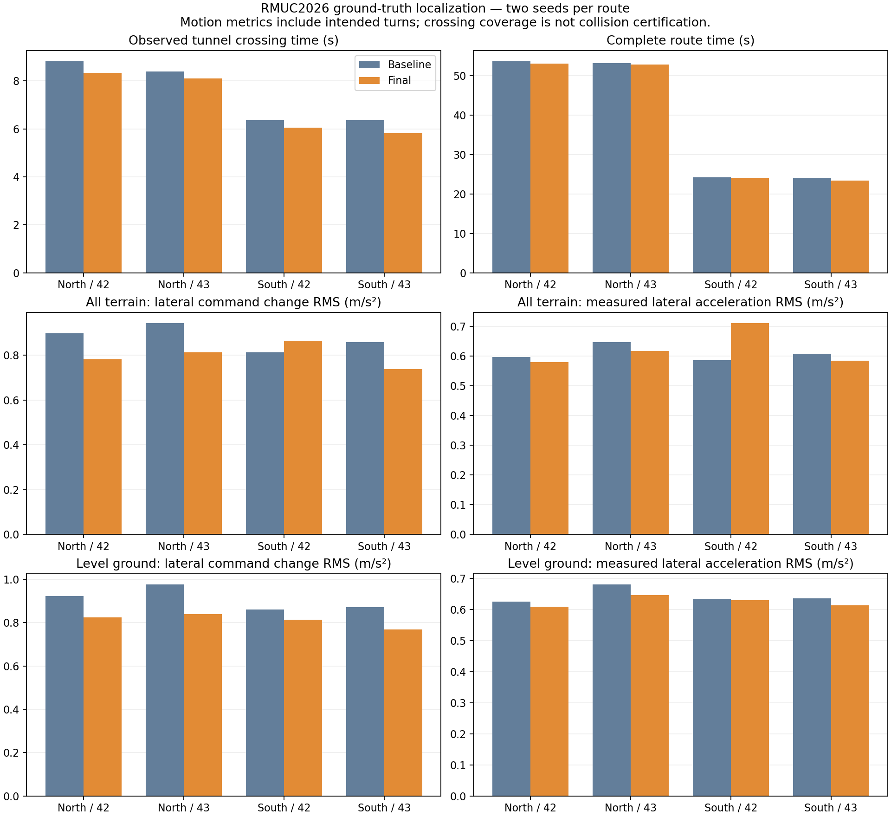

# 2026-10-28 横向控制与过洞效率优化

针对 Gazebo 中“车身横向摆动、朝向基本不变”和洞口犹豫，修复 MPC 参考时序、增加速度指令变化惩罚，并调整局部规划的停车与近障碍速度策略。验证发现的坡道长停也继续处理：局部引导现在可在已观测安全范围内提前绕开坡沿。

## 实现

- MPC 增加 `control_delta_weight`，惩罚相邻速度指令之差，保持稳态巡航速度。首次求解／重置后以实测速度为起点，已有速度、加速度约束继续生效。默认权重为零，仿真使用 `[6.0, 6.0, 0.5]`。
- 空间参考点按实测位置寻找，再分别补偿状态与参考时间；修复过去先外推位置再前推参考造成的重复提前。预测状态 `x_1…x_N` 对齐 `t+dt…t+N*dt`。
- 同一规划会话的正常滚动换轨迹仅继承有界的时间提前量，避免每次换轨迹重新减速；新任务、阻塞、制动继续重置。仿真提前量上限从 0.05 s 调整为 0.15 s，横向跟踪权重从 120 调为 60。
- 近障碍限速在 `safe_dist=0.33 m` 与 `obstacle_slowdown_distance=0.50 m` 间连续过渡，避免速度上限在 0.8／1.5 m/s 间跳变。取消距目标不足 1 m 时对普通滚动终点的额外停车要求；真实目标与观测边界依然停车。
- 增加 `local_path.repair_max_offset`，默认关闭，仿真为 0.20 m。路径被观测安全边界裁短或半格侧向余量不足时，尝试平滑横移局部引导，保留起点及真实目标。以 5 cm 递增尝试两侧，顶点和连接段均检查完整 footprint，搜索预算为 100 ms（协作式，在查询之间检查）。失败时保留已检查的停车前缀，最终 MINCO 轨迹仍需通过原有安全及动力学校验。

本轮只调整仿真 YAML；公共 C++ 修复同时作用于实车和仿真。实车的指令变化惩罚与局部修复仍默认关闭，未进行实车调参或验证。

## 同配置仿真对照

环境为 RMUC2026、Gazebo、MINCO、GT 真值定位，与当前默认启动脚本一致。每次重启仿真并使用独立 Gazebo partition；种子为 42、43。正常五目标路线覆盖北洞及坡道，南侧三目标路线往返穿洞。

| 路线／种子 | 基线全程 | 优化后全程 | 基线洞内累计时间 | 优化后洞内累计时间 |
|---|---:|---:|---:|---:|
| 北侧／42 | 53.614 s | 53.060 s | 8.820 s | 8.340 s |
| 北侧／43 | 53.174 s | 52.781 s | 8.400 s | 8.100 s |
| 南侧／42 | 24.155 s | 23.945 s | 6.360 s | 6.060 s |
| 南侧／43 | 24.115 s | 23.414 s | 6.360 s | 5.820 s |

四组完成 **16/16** 个目标，最大真值终点误差 0.172 m，均低于 0.35 m 门限。八次完整过洞累计耗时 **29.940 → 28.320 s（减少 5.4%）**；路线累计耗时 **155.058 → 153.200 s（减少 1.2%）**。最终运行目录为 `damping6_gt42/43`、`damping6_south_gt42/43`。

按有效移动时间加权，全程横向指令变化 RMS 为 **0.8954 → 0.7988 m/s²（降低 10.8%）**；实测横向加速度 RMS 为 **0.6155 → 0.6156 m/s²（总体持平）**。

检查峰值发现南侧种子 42 的较大冲击位于车身明显倾斜的坡道接触段，故另外报告平缓路段：要求相邻采样的 `|pitch|`、`|roll|` 均小于场景既有坡道阈值 0.06 rad，直接排除不符的采样对，不跨过被排除的数据补线。该子集实测横向加速度 RMS **0.6480 → 0.6263 m/s²（降低 3.4%）**，横向指令变化 RMS **0.9257 → 0.8205 m/s²（降低 11.4%）**，四组的实测指标均下降。此拆分是在检查坡道冲击后补充的诊断，完整指标同时保留；两者均包含主动转弯，不能等同于纯横摆幅度，也不能据此声称横摆消失。

此前权重 `[3,3,0.5]` 的方案全程更快（148.636 s），但平滑作用较弱。最后选择 `[6,6,0.5]`，在保持过洞及全程快于基线的同时加强行驶平滑性；中间数据保留为 `weight3_comparison.json/png`。

基线与最终对照均无持续 ≥1 s 的非目标停车；≥0.1 s 的短停候选由 3 次变为 0 次。停车审计排除任务开始 2 s 和距目标 0.35 m 内；“0 次”不代表任何时刻都没有减速。完整过洞要求连续中心轨迹经过区域两侧，采样缺口超过 0.3 s 会中断证据，不能替代扫掠车身的碰撞检测。



## 坡道异常的定位与复验

中间版本 `continuous_gt43` 在第五段、真值约 `(-4.762, -3.978)` 处出现 **3.84 s** 停顿。局部观测把前左车身附近的坡沿判为净空不足；全局路线仍贴着该边界，原处理只能裁短并停车，随后等待低速脱困。

新增局部安全绕行后，权重为 3 的 `bounded_gt42`、`bounded_gt43` 日志分别实际报告 7、6 次成功修复。原故障种子的第五段在 4.503 s 内完成，经过原卡点附近时实测速度约 0.58 m/s。相同权重的额外复跑 `bounded_repeat_gt43` 为 **5/5、52.680 s、0 次 ≥1 s 停顿**。最终权重为 6 的两种子完整路线也实际触发局部修复，均无 ≥1 s 停顿。上述复跑不能证明消除了所有可能的随机异常，原始失败记录仍保留。

## 测试与数据来源

- 当前安装库下：控制器 **53** 个、规划器 **151** 个 GTest 用例通过（共 18 个 CTest 目标）；批测工具 **21** 个 Python 用例通过。
- 20 Hz、厘米级交替测量扰动、0.13 s 底盘响应滞后的闭环测试中，增加变化惩罚使横向指令差平方和 **1.598796 → 0.275585**（权重为 6），保持 0.5 m/s 稳态速度，横向剩余误差小于 5 mm。权重为 3 的用例也通过。这是受控合成用例，不能当作 Gazebo 横摆幅度的百分比改善。
- 参考时序集成测试覆盖直行、斜行、侧移、重复参考刷新与正常换轨迹。相同测试在旧实现下命令约 0.5411 m/s（目标 0.5）而失败，修复后通过。
- 局部修复测试覆盖安全侧绕行、未知横带、真实终点保持及边界变硬前的余量偏好；原有碰撞、停止、恢复、规划会话与动力学校验继续通过。

北侧基线使用上一轮 `20261028_smoothing/enabled_seed42/43`：参数与本轮初始配置语义一致，核心库与本轮初始库对应。南侧基线通过暂时恢复本轮改动前的控制器与规划器逻辑重新构建运行；运行后恢复新代码并重新构建。四组最终运行记录参数、运行时节点状态、二进制及 DDS 哈希，详见下列索引。表中收益为整套改动的联合结果，不能归因于某一项参数。

- [最终对照指标](../tools/navigation_benchmark/results/20261028_stability/comparison.json)
- [参数与二进制核对](../tools/navigation_benchmark/results/20261028_stability/comparison_provenance.json)
- [控制器测试](../tools/navigation_benchmark/results/20261028_stability/final_controller_tests.log)、[规划器测试](../tools/navigation_benchmark/results/20261028_stability/final_planner_tests.log)
- [额外坡道复跑](../tools/navigation_benchmark/results/20261028_stability/extra_repeat.json)
- [全部原始目录，包含未采用的试验](../tools/navigation_benchmark/results/20261028_stability/)

保留的验证限制与异常记录：

- `bounded_south_gt43` 首次启动时地图服务配置响应超时，地图未激活，规划器因缺少静态地图拒绝启动。中断该次任务，在新 ROS domain 98 中按相同配置重新启动，`bounded_south_gt43_retry` 完成；首次没有产生路线数据，不计入运动对照。精确中间件原因尚未确定，见 [启动记录](../tools/navigation_benchmark/results/20261028_stability/startup_failure.json)。
- 运行结束后的进程组清理可产生 `exit code -2` 和 Gazebo 退出栈；最终成功运行的任务阶段与清理阶段分开记录在 manifest 中。
- 仓库现有 `test_navigation_launch.py` 为 39 通过、11 失败；恢复本轮初始 YAML 后仍是同样 11 项，涉及旧地图生成器与既有配置断言，见 [基线核对](../tools/navigation_benchmark/results/20261028_stability/launch_test_comparison.json)。不能把本轮核心测试通过表述为全仓库测试通过。
- 早期完整 Point-LIO 定位链试跑保留在 `baseline_south42`、`candidate_south42`；最终方案的数字以 GT 配置为准，不外推至完整定位链、其他地图或实车。

## 复现与使用

工作区已构建安装；默认仿真配置包含这些更改，重新启动当前 Gazebo 导航即可使用。

```bash
source /opt/ros/jazzy/setup.bash
source install/local_setup.bash
MAKEFLAGS='-j4 -l4' colcon build --base-paths src \
  --packages-select minco_planner minco_controller --executor sequential \
  --symlink-install --cmake-args -DBUILD_TESTING=ON
source install/local_setup.bash
ctest --test-dir build/minco_controller --output-on-failure
ctest --test-dir build/minco_planner --output-on-failure
python3 -m pytest -q tools/navigation_benchmark/test_*.py

# 使用空闲 ROS domain 和不存在的输出目录；--mode gt 明确定位模式。
python3 tools/navigation_benchmark/batch.py --domain 97 --mode gt --repeats 1 --seed 43 \
  --output /tmp/rm27-stability-check \
  --params src/pb2025_nav_bringup/config/simulation/minco_params.yaml \
  --goals '[[5.231,5.213],[-3.535,6.374],[-4.56,-2.03],[-3.94,-4.89],[-4.56,-2.03]]'
```

`stability_report.py ROOT... --output comparison.json` 汇总路线、停车、完整过洞和横向变化；`plot_stability.py` 重绘本轮对照图。指令先按真值 yaw 从车体系转到世界系，再投影到实测平均移动方向的法线，避免把车体系分量直接当作地图横向速度。
