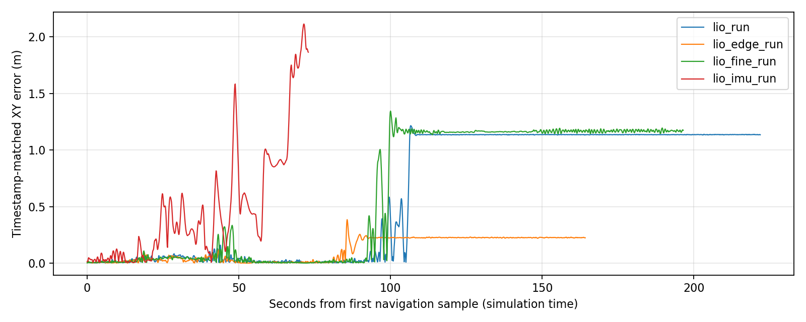

# 2026-10-28 隧道问题与 Point-LIO 复测

> 后续集成状态：根据随后“也接入这个”的要求，已将停车 GICP 校正接入 Point-LIO 全局启动入口。
> 下文“不启用后端”的运行数据与分析保留为历史基线；当前行为与启动开关见
> [仿真导航说明](simulation_global_navigation.md)。此集成不代表下文所有连续过洞问题均已解决。

本轮已将正常仿真入口及全局重定位导航入口切换为 Point-LIO。隧道问题尚未全部解决；下列失败记录必须保留，不能只统计导航 action 的成功状态。持续重定位后端按用户要求仅分析，未实现。

## 原用户运行的证据

原运行 `~/.ros/log/2026-10-28-17-26-42-989667-powercenter-231325/` 使用 Gazebo 真值相对里程计。对应 `rm27_ground_truth_localizer_231692_1793179609440.log` 明确记录真值输入，并且仅初始化一次 `map→odom`。因此该次用户运行的问题不能归因于 Point-LIO 长时间漂移。

`planner_server_mt_231698_1793179609477.log` 显示两类规划问题：

- 在约 `(4.76, 7.33)` 的坡道衔接区，全局路线靠近地面高度突变，车身角点探入另一高度区域。局部 ROG 反复报告 `OVERHEAD_GROUND_UNVERIFIED`、`HEADROOM_BLOCKED`，短距离修复后又回到全局引导线。
- 向 `(-12.343, 3.146)` 的任务第 21 秒，以及向 `(-9.574, 2.878)` 的任务第 7.5 秒，可安全前进的局部路径变短，触发全局重搜；随后冷启动方向余弦分别为约 `-0.97`、`-0.98`。这两次反向发生在之后的人工换目标之前。原运行也存在人工取消/替换目标，不能把所有路径变化都当作自动改道。

已实现的路线稳定策略只推迟全局引导线更换：同一目标仍有至少 0.20 m 沿路进展时保留当前通道；1.50 秒没有有效进展则允许重新选路。横向调整和退回旧位置不延长等待。局部碰撞校验、停车轨迹和停止命令始终有效。测试覆盖换目标、反向运动、计时异常及真正受阻后的恢复。

## Point-LIO 切换与交接

`tools/global_relocalization/navigate.bash` 默认使用 `use_ground_truth_odom:=false`。普通 `sim_with_nav.launch.py` 和 `rm_navigation_simulation_launch.py` 的默认值也改为 false。

全局定位模式下实际链路为 LiDAR/IMU → Point-LIO → loam_interface / sensor_scan_generation → MINCO。
新增 `global_pose_handoff.py` 仅完成一次全局初始化：

`T_map_odom = T_map_base(t_match) × inverse(T_odom_base(t_match))`

必须取得匹配时间的 TF，不回退到最新位姿。初值通过 `/relocalization/initialpose` 交接，确认通过 `/relocalization/initialpose_accepted` 返回。重复交接只确认，不重置运行中的定位。该模式不启动 GICP 管理器，避免两个节点同时发布 `map→odom`。开始全局旋转前等待连续的底盘里程计，避免在 Point-LIO IMU 初始化尚未完成时运动。

独立测量程序读取 Gazebo 真值用于位置误差和实际到达判断；真值不输入导航、Point-LIO 或交接节点。运行图验证确认 `/odometry` 的发布者为 `sensor_scan_generation`，没有 `rm27_ground_truth_localizer`。

## 实测结果与误差

所有对照从 `(-9.272, 0.819, 0)` 出生，依次目标 `(12.412,3.864)`、`(-12.343,3.146)`、`(6.98,8.15)`、`(-9.574,2.878)`。

| 对照 | 实际结果 | 关键现象 |
|---|---|---|
| Point-LIO 原前端参数 + 路线稳定策略 | 前三段到达，第四段 120 秒超时 | 第三段最大匹配时间 XY 误差 0.584 m；第四段最大 1.215 m，停车后约 1.135 m |
| 加入全局高程边缘避让，硬距离 0.44 m | 前两段到达，第三段卡住后人工取消 | 回程用时 49.02 → 37.43 s；第三段最大 XY 误差 0.385 m，定位落到静态障碍边界 |
| 再将前端地图体素 0.20 → 0.10 m、平面拟合阈值 0.10 → 0.05 m | 前两段到达，第三段超时 | 第三段最大 XY 误差 1.344 m，未通过验收 |
| 再切换 IMU 输入模型 | 第一段 action 成功但实际位置不合格 | 实际离目标 1.939 m，独立验收判为失败 |

这些只是每种配置一次独立启动，不是统计显著性结论；重定位旋转、调度及观测会使轨迹不同。未通过的前端参数不设为默认。

误差使用保存的 TF 时间戳与同一时刻线性插值的真值比较，插值间隔限于 0.3 秒。它仍包含插值近似误差。仅把最新 TF 与当前真值直接相减会夸大运动中的误差，因此不采用该值作为漂移证据。

原前端第一、二段对齐后误差中位数约 0.019、0.017 m，95 分位约 0.063、0.075 m；第三段进入平台衔接区域后快速增大，第四段停车后误差仍保持 1.13 m。运行中 `map→odom` 不变，点云与里程计消息时间戳差均为 0，观察到的输出间隔约 0.10 秒且没有超过 0.25 秒的断流。因此严重偏差不是单纯消息延迟或全局 TF 被另一个节点覆盖造成的。



完整汇总：[comparison.json](../tools/navigation_benchmark/results/20261028_pointlio_tunnel/comparison.json)。原始 JSON、输入审计、启动与节点输出位于 `tools/global_relocalization/.build/tunnel_route_fix_20261028/`，各 `lio*_run` 与 `lio*_launch.log` 对应上表。点云采样 NPZ 不是完整 rosbag。

## 是否需要持续重定位后端（仅分析）

结论：在当前 Point-LIO 链路下，已经有实际严重漂移证据，值得加入固定地图约束。更准确的描述是“特定区域触发的局部失准及累计误差”，尚不能仅凭这些短程实验断言是运行时间本身造成的普遍漂移。

当前前端没有持续固定地图约束。局部几何约束不足、匹配到重复结构或已经写入局部地图的错误，会让错误位姿继续维持；这些是结合地点、点云数量和算法路径作出的原因假设，仍需逐帧匹配残差、可观测性及 IMU 状态证据进一步区分。仅增加滤波精度或切换输入模型没有通过本轮对照，不应继续盲目叠加参数。

另外，配置中虽然存在 `adaptive`、`map_quality` 和 `estimator.max_iterations` 字段，但本轮实际 Point-LIO 参数转储没有这些参数，当前 `src/point_lio/src/parameters.cpp` 也没有读取它们。不能把这些 YAML 字段视作已经生效的防退化与地图质量保护；当前匹配代码仍直接进行点到平面匹配和增量地图写入。

仓库已有 GICP 管理器，但 `performRegistration()` 在平移运动时跳过配准，定位成功后也跳过周期细化。它具有静止校验与重新接受能力，却不是运动中持续固定地图约束的后端；原参数单次 XY 修正门限 0.60 m，遇到本次约 1.13 m 偏差还需要更大范围的恢复路径。当前全局定位模式只使用一次性 handoff，没有启用该管理器。

建议下一步实现边界：

1. 保留 Point-LIO 为局部连续 `odom→base` 来源，固定先验地图配准仅负责 `map→odom`；始终只有一个发布者，替换一次性静态 handoff 的所有权，不叠加发布者。
2. 用时间对齐的点云/位姿、配准质量及连续多次接受门限约束纠偏，拒绝单帧跳变。不能把所有问题简单用放宽 0.60 m 门限掩盖。
3. 明显失准时先停止并失效当前轨迹，重新定位确认后再规划。大范围恢复复用现有全局匹配，但旋转必须满足空间净空条件。
4. 对相同四目标及多次往返，记录实际目标误差、隧道内停止、反向改道、TF 修正次数和误差随时间变化；同时保留失败。验收前不宣称隧道问题已经解决。

以上后端是设计建议，本轮没有修改 `relocalization_manager` 或新增持续纠偏算法。

## 保留的修改与验证边界

保留 Point-LIO 默认入口、匹配时间的初始化交接、启动前里程计就绪检查、全局路线进展保护及测试记录工具。高程避边、细地图和 IMU 输入模型本轮只存在于独立实验参数文件中；默认配置仍为原 Point-LIO 前端，未把失败实验设为默认。

启动仍使用：

```bash
bash tools/global_relocalization/navigate.bash
```

使用手写 launch 命令时，应删除旧的 `use_ground_truth_odom:=true` 或改成 `false`；显式传入 true 会覆盖默认值。正常入口保留 RViz 选点、全局定位和 MINCO 导航。

已完成构建 `minco_planner`、`pb2025_nav_bringup`；规划器 12 个 CTest 测试套件通过，交接/启动朝向 16 项及相关启动配置 7 项通过。全量启动配置测试为 47 通过、9 失败，失败涉及已有地图生成结果、几何/速度/恢复配置契约；没有把整个工作区报告为测试全绿。完整输出保存在实验目录的 `navigation_launch_tests_all.log`。

本轮自启仿真进程已停止。Point-LIO 连接与全局初始化已经打通，但四目标隧道连续导航没有通过，后端是否实施仍以用户授权范围为准。


## Point-LIO 参数与坐标链专项核查（2026-10-28）

核查对象为当前 RMUC2026、MINCO、`use_ground_truth_odom:=false` 分支；依据包括真实节点参数
快照、Point-LIO 当前源码、展开后的机器人 TF、同时间戳传感器采样，以及上节最终版本失败路线。
结论：**传感器外参和下游坐标换算在此次实测中正确；配置中存在未实现的参数项。不能把前端
长期漂移认定为已经解决，也没有发现需要再补一次 -30° 安装旋转的依据。**

### 实际生效的配置

| 项目 | 实际值及核查结果 |
| --- | --- |
| IMU / LiDAR | 100 Hz / 10 Hz，消息时间戳中位间隔 0.01 s / 0.1 s |
| IMU 融合 | `mapping.imu_en=true`；`use_imu_as_input=false` 选择 IMU 作为观测的滤波模型，仍融合 IMU |
| 加速度单位 | m/s²，`acc_norm=9.81`；世界重力 `[0,0,-9.81]` |
| LiDAR 数据类型 | 转换器产生带 ring/time 的 PointCloud2，因此 `lidar_type=2` 与接口匹配 |
| 点时间 | 转换器与前端均 `instantaneous_scan=true`，抽查点时间全部为 0，使用整帧采样时刻 |
| 实际下采样 | RMUC2026 覆盖后 `point_filter_num=1`、`filter_size_surf=0.1`、`filter_size_map=0.2`，不能把基础 YAML 的 8 / 0.2 当成运行值 |
| IMU–LiDAR 外参 | 同位置、同朝向，`extrinsic_T=[0,0,0]`、`extrinsic_R=I` 正确；在线外参估计关闭 |
| 里程计发布 | 帧末里程计与注册点云同戳、约 10 Hz；Point-LIO 自身 TF 发布关闭 |
| 初始化 | 重力方向来自静止 IMU 均值；启用 IMU 时不会直接用 `gravity_init` 当作传感器安装方向 |

`mapping.acc_cov_output=500`、`mapping.gyr_cov_output=1000` 进入输出模型的过程噪声矩阵；
IMU 观测噪声是 `imu_meas_acc_cov/imu_meas_omg_cov=0.1`。不能仅凭过程噪声数值较大就判断
配置错误。本次没有凭猜测改动滤波权重、体素尺寸、平面门限或 IMU 模型。

### 坐标转换与实测

真实静态 TF 给出 `base_footprint→imu_link` 与 `base_footprint→left_mid360` 均为：
平移 `(0, 0.126, 0.130) m`，横滚 `-0.523598775598 rad`，俯仰和偏航为 0。
这说明零外参描述的是 IMU 与 LiDAR 之间的关系，而不是它们与底盘之间的关系。

当前 TF 树的有关部分为：

```text
map → odom → base_footprint → base_link → imu_link / left_mid360
           └→ camera_init（恒等静态变换）
```

`camera_init/body` 是 Point-LIO 里程计消息的父子帧；该配置不另行发布这条 TF。
仿真中 body、imu_link、left_mid360 共位共向。下游底盘位姿的运算是：

```text
T_odom_base = T_odom_camera_init × T_camera_init_body × inverse(T_base_imu)
```

`loam_interface.lidar_odom_is_gravity_aligned=true` 保持 `odom←camera_init` 恒等，
安装旋转由最后的传感器到底盘换算处理。把安装旋转再次左乘到全局点云和里程计会引入错误。
`map→odom` 仅由重定位管理器发布，`odom→base_footprint` 由 sensor_scan_generation 发布。

本次静止、正反自转及短距离往返采样结果：

- 静止 IMU 加速度均值约 `[0.00000025, -4.90500137, 8.49570842] m/s²`，与 -30° 安装下理论
  `[0, -4.905, 8.49570921]` 一致；不应把 IMU 本体 Y 轴上的 -4.905 当成横向加速度漂移。
- 使用真值姿态与安装变换换算后的陀螺观测误差 95 分位约 0.0053 rad/s；加速度观测与真值
  速度差分的误差 95 分位约 0.0283 m/s²。加减速/接触瞬间的最大差分残差更大，这不是传感器
  精度标定结果。真值只供观察，没有送回 Point-LIO。
- 1,904 对同戳里程计的完整矩阵换算误差：平移最大 `1.12e-16 m`、旋转最大 `6.84e-16 rad`。
  原先失败长路线另外核对了 2,193 对同戳数据，平移换算残差最大 `8.90e-16 m`。
- 当前 Point-LIO 原始 `/aft_mapped_to_init.twist` 没有填入状态速度，为零；导航使用的 `/odometry`
  由 sensor_scan_generation 对底盘位姿求差分，本次实测最大线速度约 1.37 m/s。控制器没有拿原始
  零 twist 当作底盘速度。`loam_interface` 关于上游总会发布 twist 的旧注释不符合当前前端行为。
- 原始 LiDAR/IMU、转换点云、注册点云、里程计的帧名均与这条链一致。采集脚本首次读取混合类型
  PointCloud2 时退出，修正后续采集为追加模式；采集文件中的约 56 秒空档来自观察程序重启，
  不能当作传感器断流证据。时间间隔与配对检查排除了这段采集空档。

### 配置中发现并修正的问题

仿真两份参数文件各清理了 **33 个当前前端未声明/读取的设置**：`estimator.max_iterations`、
`input_guard.*`、`map_quality.*`、`adaptive.*`，以及 `mapping.max_neighbor_distance` 和
`mapping.max_points_per_voxel`。当前源码仍是固定 5 邻点平面匹配、单次 EKF 更新；这些 YAML
设置并没有提供自适应匹配、退化保护或低质量点云暂停入图功能。

将仿真 `imu_time_inte` 从 0.005 改为 0.01，并修正过时的“PoseImuSystem 200 Hz”注释。
**该变量虽然被声明/读取，当前积分代码实际使用消息时间差，所以此项整理不会直接消除漂移。**
所有已经参与计算的滤波调参值保持一致。增加配置契约回归，检查仿真 YAML 中的前端参数必须
被当前源码声明，并检查标称 IMU 周期与模型频率一致。

另有需要明确的实现限制：`common.time_diff_lidar_to_imu` 当前虽然被读取，但没有接到 IMU
回调的时间修正表达式；当前配置为 0，仿真传感器共用时钟，这次没有非零时间偏移需求。
以后做非零时间标定时不能只修改这个 YAML 项。`mapping.det_range/fov_degree` 也没有进入当前
预处理的距离/FOV门限；本次没有依赖这两个参数裁剪仿真点云。

### 对上次过洞失败的判断

失败长路线第三段，按 TF 时间戳对齐真值后，XY 误差最大约 1.03 m；同段 Z 误差最大约
0.054 m。注册点云数量中位数从前两段约 1,304 / 1,239 点降到约 478 点，最低 258 点。
后级坐标转换残差仍在浮点误差范围，因此没有证据把这段约 1 m 偏差归因于下游 TF 方向或
重复安装角。稀疏/退化几何下的前端估计与局部地图质量值得优先继续定位；尚不能仅凭这些
日志证明某一个噪声参数就是根因。

停车后 GICP 曾提出约 -2 m 的 Z 修正，但这与上述真实 Z 误差不符；它是被拒绝的匹配候选，
不能把候选值当成实际高度漂移。现有停车后端只调整 `map→odom`，没有重置 Point-LIO 的
内部状态和已经积累的局部地图。

验证：5 组现有功能测试（瞬时点云、EKF 噪声、安装坐标、底盘速度与 TF 有效性）通过；
10 项针对性配置/启动回归通过。实测短距离两次往返共 4 个导航目标均到达，另完成正反自转。
这是坐标及输入链核查，不是完整隧道长路线已经通过的证明。

证据目录：`tools/global_relocalization/.build/pointlio_contract_audit_20261028/`，包含
`sensor_contract.json`、`failed_run_frame_check.json`、`removed_ignored_parameters.json`、
`sensors.jsonl`、参数快照、运行日志与测试输出。没有录制完整 rosbag。
