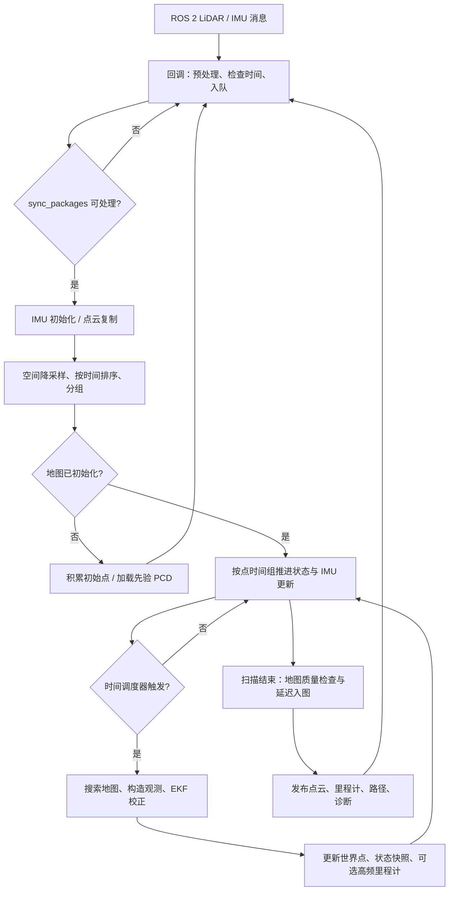

# Point-LIO 学习笔记：结合本仓库源码理解算法与工程实现

> 阅读对象：希望从 ROS 2 节点一路读到状态估计公式，并能在本工程中调试 Point-LIO 的开发者。  
> 目录迁移说明：Point-LIO 现位于 `src/pnx-localization/point_lio`，已改为主仓库中的普通目录；下述子仓库 HEAD 仅用于标识迁移前的代码基准。
>
> 代码基准：2026-10-27 当前工作区的 `src/pnx-localization/point_lio`，子仓库 HEAD 为 `2160a28`，包含工作区内已有的 `laserMapping.cpp` 修改。本文按实际文件解读，不把上游论文、README 或历史验收记录当作当前实现的替代。行号对应本文编写时的源码，后续修改后请优先按函数名定位。  
> 验证范围：源码阅读、调用关系和配置核对；本文没有重新运行算法、采集数据或复现实车精度。

## 目录

1. [先建立整体认识](#1-先建立整体认识)
2. [源码地图与推荐阅读路线](#2-源码地图与推荐阅读路线)
3. [坐标系、变量与时间约定](#3-坐标系变量与时间约定)
4. [从启动入口走进主循环](#4-从启动入口走进主循环)
5. [点云预处理：最重要的是逐点时间](#5-点云预处理最重要的是逐点时间)
6. [传感器缓存与时间同步](#6-传感器缓存与时间同步)
7. [初始化到底做了什么](#7-初始化到底做了什么)
8. [两套状态模型：IMU 作为输入或观测](#8-两套状态模型imu-作为输入或观测)
9. [误差状态滤波与预测过程](#9-误差状态滤波与预测过程)
10. [LiDAR 更新：从近邻到点面残差和雅可比](#10-lidar-更新从近邻到点面残差和雅可比)
11. [空间自适应：多尺度平面、鲁棒权重与退化处理](#11-空间自适应多尺度平面鲁棒权重与退化处理)
12. [时间自适应：什么时候值得做一次更新](#12-时间自适应什么时候值得做一次更新)
13. [iVox 地图与延迟入图](#13-ivox-地图与延迟入图)
14. [点云、里程计、TF 与 PCD 输出](#14-点云里程计tf-与-pcd-输出)
15. [本工程配置与参数理解](#15-本工程配置与参数理解)
16. [读源码发现的实现差异与待核对项](#16-读源码发现的实现差异与待核对项)
17. [运行观察、排查与学习实验](#17-运行观察排查与学习实验)
18. [自测问题与源码索引](#18-自测问题与源码索引)

## 1. 先建立整体认识

### 1.1 Point-LIO 在估计什么

Point-LIO 接收 LiDAR 点和 IMU 测量，维护传感器的运动状态及其不确定性。IMU 提供相邻时刻之间的运动信息，LiDAR 通过当前点与已有地图的几何关系纠正运动估计，纠正后的点再用于扩展地图。

用一个循环概括：

```text
已有状态和地图
  → 将状态预测到当前测量时刻
  → 把当前 LiDAR 点变换到世界系
  → 在地图中搜索近邻并拟合平面
  → 根据点到平面的偏差校正状态和协方差
  → 使用校正后的状态生成世界点
  → 经过质量检查后更新地图
```

这里有两个必须同时理解的量：

| 量 | 含义 | 典型源码符号 |
|---|---|---|
| 状态 | 当前对位置、姿态、速度等物理量的估计 | `kf_output.x_` / `kf_input.x_` |
| 协方差 | 估计误差的大小，以及不同状态误差之间的关联 | `P_` / `get_P()` |

LiDAR 观测直接涉及位置、姿态、外参，但通过协方差的交叉项，还能间接影响速度、偏置等状态。因此不能把它理解为“点云配准给出位姿，然后另一个模块单独积分 IMU”。

### 1.2 “逐点”应该怎样理解

本实现首先按点的采样时间排序，再把时间相同的点放在一个组里，逐组推进状态。关闭时间自适应时，每个时间组都会尝试一次 LiDAR 更新；开启后，会在保留逐组预测的基础上，积累若干组再更新。

所以，当前代码中“逐点处理”不等于“每个原始点都单独运行一次滤波”：预处理抽样、空间降采样、同时间分组、时间自适应都会影响实际更新粒度。

这种处理方式的目的，是让不同采样时刻的点使用对应时刻的运动状态。它依赖准确的点时间、正确的外参和合理的运动模型；不能由此推断任何输入条件下都没有畸变。

### 1.3 本包的能力边界

`src/pnx-localization/point_lio` 的主线是局部里程计和增量点云地图。它没有在本包中实现完整的回环检测、全局位姿图优化或无初值全局重定位。加载先验 PCD 是另一条地图初始化路径，也不自动等于全局重定位。

本仓库还包含以下扩展，后文会单独展开：

| 扩展 | 解决的问题 | 入口 |
|---|---|---|
| 空间自适应 | 固定邻域在不同密度和几何条件下不够灵活 | `buildLidarMeasurement()`、`fitPlane()` |
| 时间自适应 | 每个点时间组都更新的计算成本较高 | `TemporalUpdateScheduler` |
| 输入保护 | 时间回退、异常扫描、队列积压、IMU 间隙 | `li_initialization.cpp` |
| 地图质量控制 | 可疑状态产生的点污染后续匹配地图 | `queueMapIncremental()` |
| 全量世界点云 | 定位降采样后，下游仍需要更密集的点云 | `enqueueFullCloud()` 等 |
| 诊断与数值保护 | 观察更新质量，降低数值异常传播 | `publish_diagnostics()`、`esekfom.hpp` |

## 2. 源码地图与推荐阅读路线

### 2.1 各文件负责什么

路径均相对 `src/pnx-localization/point_lio`：

| 文件 | 主要职责 | 建议先看的内容 |
|---|---|---|
| [CMakeLists.txt](../src/pnx-localization/point_lio/CMakeLists.txt) | 编译、依赖、测试和安装目标 | `add_executable(pointlio_mapping ...)` |
| [launch/point_lio.launch.py](../src/pnx-localization/point_lio/launch/point_lio.launch.py) | 单包启动及 YAML 选择 | `generate_launch_description()` |
| [src/laserMapping.cpp](../src/pnx-localization/point_lio/src/laserMapping.cpp) | 主循环、预测更新调度、地图管理、发布 | `main()`，约 L735 起 |
| [src/parameters.cpp](../src/pnx-localization/point_lio/src/parameters.cpp) | 参数读取、默认值和初始协方差 | `readParameters()`、`reset_cov_output()` |
| [src/li_initialization.cpp](../src/pnx-localization/point_lio/src/li_initialization.cpp) | LiDAR/IMU 回调、缓存和同步 | `imu_cbk()`、`sync_packages()` |
| [src/preprocess.cpp](../src/pnx-localization/point_lio/src/preprocess.cpp) | 各雷达格式解析、时间转换、抽样、切帧 | `avia_handler()`、`velodyne_handler()` |
| [src/IMU_Processing.cpp](../src/pnx-localization/point_lio/src/IMU_Processing.cpp) | IMU 均值初始化、重力方向对齐 | `IMU_init()`、`Set_init()`、`Process()` |
| [include/common_lib.h](../src/pnx-localization/point_lio/include/common_lib.h) | 状态声明、点类型、时间分组、基础平面拟合 | `state_output`、`time_compressing()` |
| [src/Estimator.cpp](../src/pnx-localization/point_lio/src/Estimator.cpp) | 连续状态模型、雅可比、LiDAR/IMU 观测 | `get_f_output()`、`buildLidarMeasurement()` |
| [include/adaptive_lio.hpp](../src/pnx-localization/point_lio/include/adaptive_lio.hpp) | 空间/时间自适应算法与诊断结构 | `fitPlane()`、`TemporalUpdateScheduler` |
| [include/IKFoM/IKFoM_toolkit/esekfom/esekfom.hpp](../src/pnx-localization/point_lio/include/IKFoM/IKFoM_toolkit/esekfom/esekfom.hpp) | 流形上的预测、卡尔曼增益和协方差更新 | `predict()`、两个 `update_*()` |
| [include/ivox/ivox3d.h](../src/pnx-localization/point_lio/include/ivox/ivox3d.h) | 体素哈希索引、近邻查询、容量管理 | `GetClosestPoint()`、`AddPoints()` |
| [include/ivox/ivox3d_node.hpp](../src/pnx-localization/point_lio/include/ivox/ivox3d_node.hpp) | 单个体素内的点存储和查询 | `IVoxNode::InsertPoint()` |
| [test/test_adaptive_lio.cpp](../src/pnx-localization/point_lio/test/test_adaptive_lio.cpp) | 自适应算法、时间分组、体素容量的单元测试 | 9 个 `TEST(AdaptiveLio, ...)` |

### 2.2 推荐分三轮阅读

第一轮只理解数据怎么走：`launch → main → callback → sync_packages → 主循环 → 发布`。遇到矩阵先记下输入输出，不必立刻推导。

第二轮理解估计：先看 `common_lib.h` 的状态顺序，再看 `get_f_*()`、`df_dx_*()`、`buildLidarMeasurement()`，最后看 `esekfom.hpp` 怎样使用这些函数。

第三轮理解本仓库扩展：阅读 `adaptive_lio.hpp`，再回主循环找调度与重锚定，最后读延迟入图、全量点云与诊断。这样能避免一开始陷入 MTK 宏展开而失去主线。

## 3. 坐标系、变量与时间约定

### 3.1 三个核心坐标系

本文使用以下记号：

| 记号 | 含义 | 对应变量/消息 |
|---|---|---|
| L | LiDAR 点坐标系 | `point_lidar`、输入点的 `x/y/z` |
| I | IMU/body 坐标系 | `point_imu`、消息中的 `body` |
| W | 滤波器世界坐标系 | `camera_init` |
| R | 从 I 到 W 的旋转 | `state.rot` |
| p | IMU 原点在 W 中的位置 | `state.pos` |
| R_IL | 从 L 到 I 的旋转 | `Lidar_R_wrt_IMU` / `offset_R_L_I` |
| t_IL | LiDAR 原点在 I 中的位置 | `Lidar_T_wrt_IMU` / `offset_T_L_I` |

标准变换为：

$$
q_I = R_{IL}q_L + t_{IL},\qquad q_W = Rq_I + p.
$$

展开后：

$$
q_W = R(R_{IL}q_L+t_{IL})+p.
$$

这正是 [Estimator.cpp 的 `pointBodyToWorld()`](../src/pnx-localization/point_lio/src/Estimator.cpp#L412) 所表达的变换。它也帮助确定外参方向：`extrinsic_T/R` 表示 LiDAR 相对 IMU 的位姿。雷达相对底盘 `base_link` 的安装变换是另一层关系。

**需要对照实际调用链：**当前主更新中的固定外参缓存存在与上述公式不一致之处，见第 16.1 节。阅读时应把“变换约定”和“某条路径是否正确执行了该变换”分别核对。

### 3.2 常见容器名不等于其物理含义

| 名称 | 当前实际用途 |
|---|---|
| `Measures.lidar` | 预处理后的点云，已经可能被抽样和过滤 |
| `Measures.imu` | 主要供 IMU 初始化使用的样本集合 |
| `imu_deque` | 稳态主循环直接消费的 IMU 缓存 |
| `feats_undistort` | `ImuProcess::Process()` 输出的点云；当前函数主要复制数据，没有传统整帧去畸变过程 |
| `feats_down_body` | 空间降采样并按时间排序的匹配点；名字含 `body`，点通常仍以 LiDAR 坐标表示 |
| `feats_down_world` | 匹配点对应的世界系结果 |
| `Nearest_Points[i]` | 第 i 个匹配点的地图近邻缓存 |
| `active_lidar_points` | 当前一次 LiDAR 更新真正参与建模的点集合 |
| `pending_temporal_points` | 等待时间调度器触发更新的积累点 |
| `full_cloud_queue` | 全量输出路径中尚未变换的带时间点 |

### 3.3 时间约定必须记牢

`PointType` 是 `pcl::PointXYZINormal`，但 `curvature` 在本包中复用为**相对扫描起点的时间偏移，单位毫秒**，不是用于几何分析的曲率。

$$
t_i = t_{scan\_begin} + \frac{\texttt{point.curvature}}{1000}.
$$

例如帧头时间为 `12.000 s`，某点 `curvature = 37.5`，该点采样时间就是 `12.0375 s`。

| 时间变量 | 作用 |
|---|---|
| `Measures.lidar_beg_time` | 当前扫描起点，秒 |
| `lidar_end_time` | 根据本扫描最大点时间计算的结束时刻，秒 |
| `time_current` | 当前点时间组的时刻，秒 |
| `time_predict_last_const` | 观测型模型上次名义状态传播时刻 |
| `time_update_last` | 上次协方差传播时刻 |
| `t_last` | IMU 输入型分支的状态传播时间基准 |

状态传播时间和协方差传播时间分开记录，是后面 `prop_at_freq_of_imu` 能节约计算的基础。

## 4. 从启动入口走进主循环

### 4.1 可执行程序与节点名

`CMakeLists.txt` 把六个 `.cpp` 编译成 `pointlio_mapping`。程序在 `main()` 内创建名为 `laserMapping` 的节点。

存在两种启动入口：

| 入口 | 节点名 | 参数来源 |
|---|---|---|
| 本包 `point_lio.launch.py` | 默认 `laserMapping` | 默认 `config/mid360.yaml`，可用 `point_lio_cfg_dir` 替换 |
| bringup 的 `localization_launch.py` / `slam_launch.py` | 通过 launch 改名为 `point_lio` | bringup 的 `configured_params` 及 launch 内覆盖值 |

因此，运行导航整套 launch 时，不能只修改本包 `mid360.yaml` 就假定导航参数也会改变。实际生效值应从运行节点读取。

### 4.2 初始化工作

[`main()` L735 起](../src/pnx-localization/point_lio/src/laserMapping.cpp#L735) 依次执行：

1. 初始化 ROS，创建 `SingleThreadedExecutor`。
2. `readParameters()` 创建 `Preprocess`、`ImuProcess` 并读取参数。
3. 检查时间自适应和在线外参估计是否冲突；若两者都开，关闭时间自适应。
4. 创建 iVox 地图，设置降采样尺寸和 LiDAR–IMU 外参。
5. 给两套滤波器注册状态模型、模型雅可比和观测回调。
6. 设置初始协方差 `P` 和过程噪声矩阵 `Q`。
7. 创建传感器订阅、点云/里程计/诊断发布者和 TF 广播器。
8. 进入 `spin_some() → sync_packages() → 处理 → rate.sleep()`。



图中“扫描结束”指本扫描所有时间组处理完成；不是每次从 H 经过后都会入图。

### 4.3 为什么主循环 500 Hz 不代表里程计只有 500 Hz

外层 `rclcpp::Rate rate(500)` 控制取数据的循环节奏。一次扫描处理内有一个遍历 `time_seq` 的循环，可能执行多次成功的 LiDAR 更新及发布。因此逻辑上的消息时间间隔可以小于外层循环周期。

同时，这些消息可能在一次扫描到齐后集中算出、集中发布。高消息频率、点采样时间上的高分辨率和真实端到端低延迟是三个不同指标。本实现还会等待 IMU 覆盖扫描末尾，不能仅凭发布频率推断实时性。

## 5. 点云预处理：最重要的是逐点时间

### 5.1 类型分发

[`preprocess.h` L15](../src/pnx-localization/point_lio/src/preprocess.h#L15) 定义：

| `preprocess.lidar_type` | 枚举 | 输入形式 | 主要时间字段 |
|---:|---|---|---|
| 1 | `AVIA` | `livox_ros_driver2/msg/CustomMsg` | `offset_time` |
| 2 | `VELO16` | `sensor_msgs/msg/PointCloud2` | `time` |
| 3 | `OUST64` | `sensor_msgs/msg/PointCloud2` | `t` |
| 4 | `HESAIxt32` | `sensor_msgs/msg/PointCloud2` | `timestamp` |

名字 `AVIA` 在这里也是 Livox CustomMsg 路径的分支标记，Mid360 配置同样走它。名字 `VELO16` 也不意味着当前仿真输入一定只有 16 线。

### 5.2 Livox/Mid360 路径逐行理解

[`Preprocess::avia_handler()` L320 起](../src/pnx-localization/point_lio/src/preprocess.cpp#L320) 的核心处理为：

```cpp
// 摘自源码，省略了容器初始化等代码
if ((msg->points[i].line < N_SCANS) &&
    ((msg->points[i].tag & 0x30) == 0x10 ||
     (msg->points[i].tag & 0x30) == 0x00)) {
  valid_num++;
  if (valid_num % point_filter_num == 0) {
    pl_full[i].curvature = msg->points[i].offset_time / float(1000000);
    // 填充 xyz、intensity，检查距离，再加入 pl_surf
  }
}
```

需要理解四件事：

1. `line < N_SCANS` 和 tag 位检查先筛选允许的点。
2. `point_filter_num` 是按合格点计数的抽样间隔。例如 8 表示约每 8 个合格候选点取 1 个，之后仍可能因距离等检查被丢弃。
3. `offset_time` 按纳秒除以 `1e6` 转成毫秒，存入 `curvature`。
4. `blind` 是近距离阈值，源码比较的是 `x²+y²+z²` 与 `blind²`。距离比较还使用预处理对象自己的 `det_range`。

这条路径直接按固定纳秒约定换算，`preprocess.timestamp_unit` 不参与这里的换算。

### 5.3 PointCloud2 路径与时间单位

普通 `process(PointCloud2)` 先根据 `timestamp_unit` 设置 `time_unit_scale`：

| 配置值 | 输入时间单位 | 转换到毫秒的系数 |
|---:|---|---:|
| 0 | 秒 | `1e3` |
| 1 | 毫秒 | `1` |
| 2 | 微秒 | `1e-3` |
| 3 | 纳秒 | `1e-6` |

Velodyne 普通路径使用 `time * time_unit_scale`，Ouster 使用 `t * time_unit_scale`。Hesai 普通路径先减去第一个点的 `timestamp`，再乘转换系数。

Velodyne 没有可用点时间时，代码还会尝试用匀速旋转模型，根据方位角估算时间。这只是模型近似；当前普通路径把 `layer` 写成 0，不能将其当作完整的逐线真实采样时间恢复。

点时间单位误配会同时影响：状态传播的 `dt`、扫描时长检查、IMU 等待条件、点云畸变和消息时间戳，往往比微调观测噪声更值得优先排查。

### 5.4 抽样、空间降采样与时间分组是三步

预处理抽样发生在雷达 handler 内；空间降采样发生在主循环；时间分组发生在排序之后。

主循环约 L925 的代码：

```cpp
downSizeFilterSurf.setInputCloud(feats_undistort);
downSizeFilterSurf.filter(*feats_down_body);
sort(feats_down_body->points.begin(), feats_down_body->points.end(), time_list);
time_seq = time_compressing<int>(feats_down_body);
```

`filter_size_surf` 控制 PCL VoxelGrid 的叶子尺寸。降采样后的点携带的时间可能随其代表点/字段处理而改变，所以本实现会再次按 `curvature` 排序。不能把降采样点简单等同于某个原始回波。

[`time_compressing()`](../src/pnx-localization/point_lio/include/common_lib.h#L115) 返回的是**每个相同时间组的点数**，不是时间列表。例如：

```text
排序后的 curvature： [0.0, 0.0, 0.5, 1.0, 1.0] ms
time_seq：            [2,        1,   2]
对应更新时刻：        0.0 ms、0.5 ms、1.0 ms
```

源码 `idx` 初值为 `-1`，每轮用 `idx + time_seq[k]` 取本组末点的时间，完成后 `idx += time_seq[k]`。在上述例子里，取时间的点索引依次为 1、2、4。

### 5.5 合帧和切帧

`common.con_frame` 把多个消息拼成一个处理单元。合帧时，每个点要加上原消息起点与合并起点的差，才能继续表达正确的相对时间。

`common.cut_frame` 将单个消息拆成多个处理单元。`cut_frame_num` 由 `lidar_time_inte / cut_frame_time_interval` 四舍五入得到，但实际切帧函数按排序后点数划分，并不是严格按相等时间区间切割；前几帧还有减少切分的特殊处理。

切帧函数对时间字段有独立实现，例如 Velodyne 切帧分支直接用 `time * 1000`，Ouster 直接用 `t / 1e6`。因此不能假定普通路径的 `timestamp_unit` 配置会统一控制所有切帧路径。

### 5.6 不要被遗留的特征提取函数分散注意力

文件后半部分保留了 `give_feature()`、`plane_judge()` 等代码和一些特征类型枚举，但当前普通 handler 主线没有调用 `give_feature()`。`pl_surf` 这个名字不能证明输出已经经过传统的显式平面特征提取。

当前主要的几何筛选发生在地图匹配时：搜索近邻、拟合平面、检查残差，再决定是否形成观测。

## 6. 传感器缓存与时间同步

### 6.1 回调做什么

[`li_initialization.cpp`](../src/pnx-localization/point_lio/src/li_initialization.cpp) 维护三条关键缓存：

```text
lidar_buffer：每个待处理扫描的点云
time_buffer：与 lidar_buffer 一一对应的扫描起点
imu_deque：按消息时间顺序存放的 IMU
```

`standard_pcl_cbk()` 和 `livox_pcl_cbk()` 预处理点云，将点云与时间同时入队。`imu_cbk()` 复制 IMU 消息，计算内部时间，再入 IMU 队列。

订阅使用 `SensorDataQoS()`；应用层还限制队列长度，默认 LiDAR 5 帧、IMU 500 条。超过上限会丢弃旧数据并增加计数，而不是让延迟无限增长。这些上限与 ROS 中间件的订阅队列深度是不同层面的设置。

### 6.2 `sync_packages()` 的核心条件

[`sync_packages()` L217 起](../src/pnx-localization/point_lio/src/li_initialization.cpp#L217) 对启用 IMU 的路径主要做：

1. 确认 LiDAR 和 IMU 队列非空。
2. 取队首 LiDAR 及起点，检查预处理后点数是否达到 `min_scan_points`。
3. 遍历点云查找最大的 `curvature`，计算 `lidar_end_time`。
4. 检查扫描时长是否有限、非负且不超过 `max_scan_duration`。
5. 等待 `last_timestamp_imu >= lidar_end_time`。
6. 若还在 IMU 初始化阶段，从队列取本扫描结束之前的 IMU 样本到 `meas.imu`。
7. 弹出当前 LiDAR 及其时间，返回 `true`。

这里的“同步”是让数据覆盖处理区间，不是自动标定两个传感器的时钟偏差。它没有使用 `message_filters` 的近似时间配对。

初始化结束后，主循环直接按点时间消费 `imu_deque`。所以只在 `MeasureGroup.imu` 中找稳态所有 IMU 数据，会读错代码。

### 6.3 数据异常如何处理

| 条件 | 源码动作 | 对算法的含义 |
|---|---|---|
| LiDAR/IMU 时间回退 | 清空传感器缓存，设置 `flg_reset` | 主循环随后进入重置分支 |
| 相邻 IMU 时间差超过阈值 | 设置 `imu_gap_detected` 并告警 | 地图更新逻辑随后暂停/清理待入图片段 |
| 扫描点太少或时长异常 | 丢弃该扫描，增加 LiDAR 丢弃计数 | 不把异常扫描送入正常匹配流程 |
| 队列超过上限 | 丢弃队首旧数据 | 优先限制积压和延迟 |

主循环重置分支会重建 iVox，并清理时间窗口、待入图点和全量点云队列等。但它是否完整重置了所有滤波状态和历史量，需要逐项检查，不能只凭 `flg_reset` 的名字认定等价于重启节点。

### 6.4 当前时间偏移参数的实现差异

参数 `common.time_diff_lidar_to_imu` 被读取到 `time_diff_lidar_to_imu`，但 IMU 回调实际减去的是：

```cpp
get_time_sec(msg_in->header.stamp)
  - timediff_imu_wrt_lidar
  - time_lag_IMU_wtr_lidar
```

当前源码没有把前者赋给后面两个变量，自动估计偏移的代码也处于注释状态。因此，**仅修改 YAML 的 `common.time_diff_lidar_to_imu`，当前代码不会据此改变 IMU 的内部时间戳**。这是读参数时必须沿“声明 → 读取 → 使用”追踪到底的例子。

## 7. 初始化到底做了什么

### 7.1 IMU 均值与重力方向

[`ImuProcess::IMU_init()`](../src/pnx-localization/point_lio/src/IMU_Processing.cpp#L57) 累积加速度和角速度均值。核心递推式为：

$$
\bar a_N = \bar a_{N-1} + \frac{a_N-\bar a_{N-1}}{N}.
$$

`MAX_INI_COUNT` 为 100，判断依据是累积样本计数，不是 100 帧 LiDAR。初始化通常需要相对静止，以便平均加速度主要反映重力对应的比力方向。

主循环使用：

$$
g_{I,init} = -\frac{\bar a}{\|\bar a\|}G,\qquad
G = \|\texttt{mapping.gravity}\|.
$$

随后 `Set_init(tmp_gravity, rot_init)` 求对齐旋转，使初始 IMU 系中的重力方向与设定世界重力方向对应，并设置两套滤波器姿态。

对于观测型状态，还设置：

$$
a_{I,init} = -R_{init}^{T}g_W.
$$

代入运动方程 `R a_I + g_W` 得到零，表达静止初始化的假设。这里的 `acc` 是比力状态，不是已经减去重力的世界系线加速度。

重力只能约束倾斜方向，不能单独确定全局航向。不能把这一步当作绝对 yaw 标定。

### 7.2 当前代码没有做的初始化步骤

虽然注释写着初始化陀螺偏置和协方差，但 `mean_gyr` 在当前实现中没有被写入 `kf_*.x_.bg`。`IMU_init()` 也没有实际计算一套样本协方差用于替代参数 `Q/R`。阅读应以赋值语句为准。

同样，`Process()` 主要完成初始化和点云复制。源码中没有在这里实现一个把整帧统一补偿到扫描末尾的去畸变循环；后续主循环按点时间推进状态才是匹配路径的关键。

### 7.3 没有 IMU 的分支

`mapping.imu_en: false` 时，主循环会跳过 IMU 初始化，使用 `gravity_init` 作为初始机体系重力方向，并通过状态模型继续工作。学习这条路径时应配合 `use_imu_as_input: false` 理解；输入型模型需要 IMU 数据来提供输入。

这条路径依然依赖 LiDAR 几何约束和所用运动模型，不能把“可以不接 IMU”理解为所有运动下都具有同样表现。

### 7.4 初始地图与先验 PCD

主循环约 L966：将初始化阶段点变到世界系，累计到 `init_feats_world`，达到 `init_map_size` 后建立 iVox。

**`init_map_size` 是点数阈值。**例如 YAML 的 10 表示至少累计 10 个点，不是 10 帧，也不是 10 米。

如果开启 `prior_pcd.enable`，则向 iVox 插入加载的 PCD 点；否则插入累计的初始化点。先验图不可用或为空时，会跳过这次初始化尝试。

先验路径还有一些特殊行为：

- `prior_pcd.init_pose` 只包含三个平移分量；当前赋值发生在 `set_posestamp()` 首次发布路径中，且只作用于 `kf_output`。
- 这不是在第一次匹配前完成的通用六自由度初值设置，尤其不应将它当作姿态初始化或全局搜索。
- 开启先验图后，正常增量入图要等 `sleep_time > 200`；这是处理计数门限，不是固定 200 秒。
- `Laser_map` 发布函数使用的是 `init_feats_world`，不能仅凭这个话题认为其内容就是加载的完整先验 PCD。

## 8. 两套状态模型：IMU 作为输入或观测

### 8.1 最容易误解的开关

| 配置 | 滤波器 | 模型含义 |
|---|---|---|
| `use_imu_as_input: true` | `kf_input` | IMU 作为运动方程输入 |
| `use_imu_as_input: false` | `kf_output` | 把角速度、比力放入状态，IMU 作为对这些状态的观测 |

因此，`false` 不表示关闭 IMU。是否订入并使用 IMU 数据，另受 `mapping.imu_en` 控制。本工程主要使用第二种模型。

### 8.2 状态定义与索引

[`common_lib.h` L24–31](../src/pnx-localization/point_lio/include/common_lib.h#L24) 用 `MTK_BUILD_MANIFOLD` 定义两套状态。下面列的是误差状态中的起始索引，每项占 3 维：

| 分量 | 物理含义 | `state_input` | `state_output` |
|---|---|---:|---:|
| `pos` | W 系位置 p | 0 | 0 |
| `rot` | I→W 姿态 R 的局部旋转误差 | 3 | 3 |
| `offset_R_L_I` | L→I 外参旋转误差 | 6 | 6 |
| `offset_T_L_I` | L→I 外参平移 | 9 | 9 |
| `vel` | W 系速度 v | 12 | 12 |
| `bg` | 陀螺偏置 | 15 | 24 |
| `ba` | 加速度计偏置 | 18 | 27 |
| `gravity` | W 系重力 g | 21 | 21 |
| `omg` | I 系真实角速度 ω | — | 15 |
| `acc` | I 系比力 a | — | 18 |
| 总误差维度 | 每项 3 维相加 | 24 | 30 |

这里 `gravity` 是 `vect3`，占 3 维。虽然头文件定义了 `S2` 类型，但当前这两套状态没有把重力声明为 `S2`，不能套用其他 LIO 代码中“重力误差只有 2 维”的索引。

### 8.3 IMU 作为输入的运动方程

[`get_f_input()` L56](../src/pnx-localization/point_lio/src/Estimator.cpp#L56) 对应：

$$
\dot p = v,
\qquad \dot R = R[\omega_m-b_g]_\times,
\qquad \dot v = R(a_m-b_a)+g.
$$

其他分量的名义导数为零，通过过程噪声表达偏置变化等不确定性。`input_in.acc` 在传入前会按 `G_m_s2 / acc_norm` 缩放。

直观理解：滤波器拿 IMU 读数扣掉偏置，把机体系比力转到世界系，加上重力，推进位置、姿态和速度。

### 8.4 IMU 作为观测的运动方程

[`get_f_output()` L70](../src/pnx-localization/point_lio/src/Estimator.cpp#L70) 对应：

$$
\dot p = v,
\qquad \dot R = R[\omega]_\times,
\qquad \dot v = Ra+g.
$$

运动方程使用状态中的 `omg`、`acc`，不直接用原始 IMU 读数。`omg`、`acc` 等名义导数为零，但相应过程噪声允许它们变化。

[`h_model_IMU_output()` L366](../src/pnx-localization/point_lio/src/Estimator.cpp#L366) 再建立 IMU 观测：

$$
\omega_m = \omega+b_g+n_\omega,
\qquad a_m\frac{G}{\texttt{acc\_norm}} = a+b_a+n_a.
$$

代码传给滤波器的创新量为：

```cpp
z_IMU.head<3>() = angvel_avr - s.omg - s.bg;
z_IMU.tail<3>() = acc_avr * G_m_s2 / acc_norm - s.acc - s.ba;
```

这里 `angvel_avr`、`acc_avr` 的名字带 `avr`，但稳态主循环里通常直接赋值为某条 IMU 消息的数值，不能仅凭变量名认定做了多样本平均。

### 8.5 为什么这种模型可以屏蔽饱和轴

当 `check_satu` 开启，代码对每轴检查：

```text
|原始角速度| >= 0.99 × satu_gyro
|原始加速度| >= 0.99 × satu_acc
```

被判定饱和的轴会设置 `satu_check`，对应创新设为 0；滤波器 IMU 更新中也不建立该轴的观测贡献。其含义是暂时不信任该轴的截断读数，而不是把截断值当成真实值积分。

这并不能恢复被截断的真实读数。剩余状态预测、未饱和轴和 LiDAR 约束仍决定估计质量。

**单位要根据比较位置判断。**加速度饱和比较使用缩放前的 `acc_avr`，所以 `satu_acc` 必须与消息中加速度数值的单位一致；陀螺阈值同理。配置中的“not related to the units”注释不足以描述这段实际逻辑。

饱和屏蔽观测只在 `kf_output` 的 IMU 更新路径中生效，不能认为切到输入型模型后仍保留同样的机制。

## 9. 误差状态滤波与预测过程

### 9.1 为什么旋转不能像位置一样直接相加

位置增量可以直接写成 `p_new = p + δp`。旋转矩阵必须保持正交且行列式为 1，不能随意对矩阵元素相加。

本实现通过 MTK 的流形操作处理更新。用右乘小旋转表达其核心形式：

$$
R_{new}=R\operatorname{Exp}([\delta\theta]_\times).
$$

`[u]×` 表示向量 u 对应的反对称矩阵，满足 `[u]×v = u × v`。`Exp` 把旋转向量映射成合法旋转。

在源码中：

| 调用 | 含义 |
|---|---|
| `x_.oplus(f_, dt)` | 根据运动模型和时间间隔推进名义状态 |
| `x_.boxplus(dx_)` | 将滤波求出的局部误差修正应用到状态 |
| `SO3::exp(...)` | 将旋转向量映射为旋转 |
| `get_P()` | 获取局部误差坐标下的协方差 |

先理解这些操作的数学意义，再进入 `mtk/build_manifold.hpp` 和 `mtk/types/SOn.hpp` 读宏与模板，会更容易。

### 9.2 名义状态传播与协方差传播被拆开

[`esekf::predict()` L146](../src/pnx-localization/point_lio/include/IKFoM/IKFoM_toolkit/esekfom/esekfom.hpp#L146) 的两个布尔参数分别控制：

```cpp
predict(dt, Q, input_in, predict_state, prop_cov);
```

| 参数组合 | 实际动作 |
|---|---|
| `true, false` | 只推进名义状态 |
| `false, true` | 只传播协方差 |
| `true, true` | 两者都做，源码按先状态后协方差的顺序执行 |

`prop_at_freq_of_imu: true` 时，主循环主要在 IMU 时刻传播协方差，而名义状态仍被推进到每个点时间组。关闭该开关后，还会在点时间传播协方差。

这是一种计算与近似的选择。它不表示开启后点状态只更新到 IMU 时刻，也不表示可以省略 LiDAR 校正中的协方差更新。

### 9.3 状态雅可比怎样读

`df_dx_output()` 给出连续误差模型的关键耦合项：

$$
\frac{\partial\dot p}{\partial v}=I,
\qquad
\frac{\partial\dot v}{\partial\delta\theta}=-R[a]_\times,
\qquad
\frac{\partial\dot v}{\partial a}=R,
\qquad
\frac{\partial\dot v}{\partial g}=I,
\qquad
\frac{\partial\dot\theta}{\partial\omega}=I.
$$

例如 `cov.block<3,3>(12,3) = -s.rot * MTK::hat(s.acc)` 表示姿态误差会改变把比力旋转到世界系的结果，从而影响速度误差。

输入型模型则把测量偏置放入运动方程，所以出现：

$$
\frac{\partial\dot v}{\partial b_a}=-R,
\qquad
\frac{\partial\dot\theta}{\partial b_g}=-I.
$$

这些块矩阵的索引必须与第 8.2 节表格配套看，不要只靠 12、15、18 等数字记忆。

### 9.4 协方差离散传播的实际形式

滤波器先构造包含流形旋转项的转移矩阵 `F_x1`，然后执行：

$$
P^- = F P F^T + Q\Delta t^2.
$$

注意这里源码明确为 **`Q * (dt * dt)`**。不能不加说明地套成另一种实现里的 `G Q_c G^T Δt`，也不能直接照搬其他滤波器的连续噪声密度参数。

`process_noise_cov_output()` 将噪声写入速度、角速度、比力及偏置对应的块。以 `acc_cov_output = 500`、`dt = 0.005 s` 为例，该块单次直接噪声注入量为 `500 × 0.005² = 0.0125`，另有 `F P Fᵀ` 对已有不确定性的传播。

名义状态传播通过 `oplus(f,dt)` 完成；不能因为后面的全量点云外推含有 `0.5 a dt²`，就认定这里的位置传播也使用了相同的二阶公式。

### 9.5 初始协方差

`reset_cov()` 为输入型状态设置基本对角值 0.1，重力块 0.0001，偏置块 0.001。

`reset_cov_output()` 为观测型状态设置基本对角值 0.01，重力块 0.0001，偏置块 0.001。

初始协方差表达先验信任程度，不是最终误差承诺。把某项设得极小相当于强烈相信它，可能使后续观测难以修正错误初值。

## 10. LiDAR 更新：从近邻到点面残差和雅可比

### 10.1 一次更新的调用链

两套模型最终共享同一套 LiDAR 观测构造：

```text
主循环：appendTemporalGroup()
  → temporal_scheduler.shouldUpdate()
  → prepareActiveMeasurements()
  → kf_*.update_iterated_dyn_share_modified()
      → h_model_input() / h_model_output()
          → buildLidarMeasurement()
              → iVox 近邻搜索
              → 平面拟合、检查和权重计算
              → 填充 h_x、z、M_Noise
      → 求卡尔曼增益与状态增量
      → boxplus() 与协方差更新
  → transformActiveMeasurements()
```

`buildLidarMeasurement()` 的位置在 [Estimator.cpp L143 起](../src/pnx-localization/point_lio/src/Estimator.cpp#L143)。它是连接几何匹配与滤波器的核心函数。

### 10.2 搜索地图近邻

对一个活动点，代码先根据当前状态得到 `point_world`，再调用：

```cpp
ivox_->GetClosestPoint(point_world_msg, points_near, query_count, query_range);
```

关闭空间自适应时，`query_count = NUM_MATCH_POINTS = 5`；开启时，默认一次查询最多 20 个点，再复用排序后的 5、10、20 点前缀。

代码还会显式按距离排序，因为 iVox 返回的候选集合不能直接当作完整有序列表使用。

### 10.3 基础路径的五点平面拟合

关闭空间自适应时，调用 [`esti_plane()`](../src/pnx-localization/point_lio/include/common_lib.h#L180)。它设平面为：

$$
u_x x + u_y y + u_z z + 1 = 0,
$$

用五个近邻构造最小二乘问题：

$$
\begin{bmatrix}
x_1&y_1&z_1\\
\vdots&\vdots&\vdots\\
x_5&y_5&z_5
\end{bmatrix}u = -\mathbf 1.
$$

通过 QR 求 u 后，归一化得到：

$$
n = u/\|u\|,\qquad d=1/\|u\|,
\qquad n^Tq+d=0.
$$

再要求每个近邻到该平面的绝对距离不超过 `plane_thr`。

这个固定常数项写法与后文 PCA 拟合不同：平面经过世界原点时，常数项无法规范成 1，可能产生数值或表达问题。因此理解基础路径时，既要看到它计算简单，也要知道其参数化的局限。

### 10.4 点到平面的残差

地图平面法向 n 已归一化时：

$$
r(x)=n^T\big(Rq_I+p\big)+d.
$$

r 是带符号距离。若当前点在预测位置上高于水平地面 2 cm，且法向向上，则 `r = +0.02 m`。

代码使用的创新量为 `z = -r`，目标是通过修正状态使残差趋近于 0。这里的 `z` 已经是创新量，不是“一个点的世界坐标测量”。

基础路径还有一条匹配门限：

$$
\|q_I\| > \texttt{match\_s}\,r^2.
$$

`match_s` 越大，在相同距离下允许的残差越小。例如点距离为 5 m、`match_s = 81` 时，残差 0.05 m 可以通过，而 0.30 m 不能通过。此门限只属于基础路径，空间自适应使用另一套归一化残差与责任度逻辑。

### 10.5 姿态雅可比的推导

对右乘小旋转：

$$
R\operatorname{Exp}([\delta\theta]_\times)q_I
\approx Rq_I - R[q_I]_\times\delta\theta.
$$

因此残差的位姿雅可比为：

$$
H_p=n^T,\qquad H_\theta=-n^TR[q_I]_\times.
$$

令 `C = Rᵀ n`、`A = [q_I]× C`，就可以将姿态项写成 `Aᵀ`。这对应源码：

```cpp
const V3D C(state.rot.transpose() * weighted_normal);
const V3D A(point_imu_crossmat * C);
```

固定外参时，单行观测矩阵的前 12 列为：

$$
H = [n^T\quad A^T\quad 0\quad 0].
$$

这里后两个零块分别对应外参旋转、外参平移，各占 3 列。

若在线估计外参，且该点没有经过时间重锚定，源码再计算：

$$
B=[q_L]_\times R_{IL}^TC,
\qquad H=[n^T\quad A^T\quad B^T\quad C^T].
$$

这就是 `h_x` 为什么只有 12 列：几何观测显式作用于位置、姿态与外参。滤波器随后把它扩展为 24 或 30 列，其余直接观测列填零。

### 10.6 从 H 和残差到卡尔曼更新

设本次观测行数为 m，完整误差状态维度为 n。测量噪声在滤波器中表示为：

$$
R_m=\sigma_L^2 I_m,\qquad
\sigma_L^2=\texttt{laser\_point\_cov}.
$$

对小观测数量分支，代码采用：

$$
K=P^-H^T(HP^-H^T+R_m)^{-1},\qquad
\delta x=Kz.
$$

对大观测数量分支，则利用状态维度小于观测行数的特点，先构造状态信息矩阵：

$$
P_{post}=(P^{-1}+H^TR_m^{-1}H)^{-1},
\qquad K=P_{post}H^TR_m^{-1}.
$$

两者解决的是同一线性化更新问题，只是求逆的矩阵维度不同。本实现保留了统一噪声尺度，空间权重通过缩放观测行实现。

位置的一维直观例子：若位置先验方差是 0.1、测量方差是 0.01、创新为 -0.02，则增益约为 `0.1 / 0.11 = 0.909`，位置修正约为 -0.0182。实际代码联合求解全部相关状态，并不是逐个分量孤立计算。

### 10.7 Joseph 形式与失败返回

LiDAR 更新使用：

$$
P^+=(I-KH)P^-(I-KH)^T+KR_mK^T.
$$

这是 Joseph 形式。之后进行对称化；如果协方差出现非有限值，则恢复此前的协方差和传播状态，返回 `false`。无有效观测、噪声非法时也会失败返回。

IMU 更新的实现不同：它利用固定观测结构构造 `PHT`、`HP`，使用 `P -= K * HP` 后再对称化。不能把 LiDAR 更新的 Joseph 实现描述为所有更新路径都相同。

### 10.8 函数名里的 iterated 不代表当前多轮迭代

`update_iterated_dyn_share_modified()` 保留了迭代结构，但 `readParameters()` 将 `estimator.max_iterations` 强制限制为：

```cpp
ekf_max_iterations = std::clamp(ekf_max_iterations, 1, 1);
```

所以当前节点实际只执行一轮。将 YAML 写成 3 或 10 不会开启多轮迭代；也不能把该实现解释成已经完成标准多轮迭代误差状态滤波的先验修正与协方差重置流程。

## 11. 空间自适应：多尺度平面、鲁棒权重与退化处理

### 11.1 为什么要多尺度

邻域太小，点稀疏时法向容易不稳定；邻域太大，可能跨越墙角、台阶或两个物体。空间自适应尝试在多个尺度上拟合同一个点附近的平面，再按一致性和几何质量分配贡献。

默认尺度为：

| 尺度 | 近邻数 | 最远近邻允许距离 |
|---|---:|---:|
| 0 | 5 | 0.35 m |
| 1 | 10 | 0.70 m |
| 2 | 20 | 1.40 m |

这些是从同一次地图查询结果取的嵌套前缀，具有相关性，不是三组独立传感器测量。代码将各尺度作为候选模型进行加权组合。

### 11.2 PCA 平面拟合

[`fitPlane()` L53](../src/pnx-localization/point_lio/include/adaptive_lio.hpp#L53) 对近邻求质心 μ 与协方差 C：

$$
\mu=\frac1N\sum_i q_i,
\qquad C=\frac1N\sum_i(q_i-\mu)(q_i-\mu)^T.
$$

设特征值为 `λ₀ ≤ λ₁ ≤ λ₂`，最小特征值对应的特征向量作为法向 n：

$$
d=-n^T\mu,\qquad
\kappa=\frac{\lambda_0}{\lambda_0+\lambda_1+\lambda_2}.
$$

这里 κ 才是几何曲率指标，与点字段 `curvature` 中的时间毫无关系。

源码拒绝以下情况：样本不足、特征分解失败、点几乎重合、第二特征值过小而近似共线、曲率过大、最大拟合残差过大。

其表面方差启发式估计为：

$$
\sigma_{surface}^2=\lambda_0/N.
$$

质量分数还综合了曲率与平面内的分布均匀程度 `λ₁/λ₂`。点很多但几乎排成一条线时，仍然不能可靠约束平面。

### 11.3 用不确定性判断残差是否异常

对每个尺度，代码计算近似创新方差：

$$
S = \sigma_L^2 + \sigma_{surface}^2
  + n^T P_{pp} n + A^T P_{\theta\theta}A.
$$

再计算归一化残差平方：

$$
\operatorname{NIS}=r^2/S.
$$

若 `sqrt(NIS)` 超过 `normalized_residual_gate`，该候选尺度不参与后续融合。

这里 S 只使用位置和姿态的对角块贡献，忽略了二者交叉协方差和外参不确定性等项，属于本实现中的近似。它不是完整状态投影得到的精确创新协方差。

### 11.4 责任度和 Student-t 权重

[`computeResponsibilities()` L108](../src/pnx-localization/point_lio/include/adaptive_lio.hpp#L108) 给每个候选模型建立分数，核心形式为：

$$
L_s \propto \pi_s\,Q_s\,
\frac{\exp(-\tfrac12r_s^2/S_s)}{\sqrt{S_s}},
\qquad
\gamma_s=\frac{L_s}{p_{outlier}+\sum_jL_j}.
$$

其中 `Q_s` 是几何质量，`π_s` 是均分给当前有效模型的尺度先验。`outlier_probability` 在代码中作为归一化分母的背景项，因此应将该结果理解为实现定义的软责任度，而不是完整标定的物理后验概率。

之后计算 Student-t 形式鲁棒权重：

$$
w_s=\frac{\nu+1}{\nu+r_s^2/S_s}.
$$

责任度低于 `min_responsibility` 的尺度被清零。单个点可以在多个尺度产生观测行，而不只是选出唯一最佳尺度。

注意 `w_s` 对很小残差可以略大于 1。因此 `effective_points` 是权重和，既不是原始点数，也不能保证等于或小于唯一关联点数。

### 11.5 为什么要同时缩放 H 和 z

滤波器仍接收统一的 `laser_point_cov`，所以每行按系数 c 缩放：

$$
c_s = \min\left(
\sqrt{\frac{\gamma_sw_s\sigma_L^2}
{\sigma_L^2+\sigma_{surface,s}^2}},
\texttt{max\_information\_scale}\right),
\qquad H'_s=c_sH_s,\quad z'_s=-c_sr_s.
$$

这样该行的有效信息贡献为：

$$
\frac{H_s'^TH_s'}{\sigma_L^2}
=\frac{\gamma_sw_s}{\sigma_L^2+\sigma_{surface,s}^2}H_s^TH_s
$$

（未触发系数上限时）。这解释了“滤波器噪声矩阵没变，但不同平面观测可信度不同”是如何实现的。

### 11.6 退化方向抑制

空间自适应开启且观测行数至少为 6 时，源码先对位姿六维部分计算：

$$
\mathcal I_{raw}=H_{pose}^TH_{pose}.
$$

特征值小于最大特征值乘 `degeneracy_eigen_ratio` 的方向被视为弱约束方向。构造可观子空间投影 Π 后，使用：

$$
H_{pose}\leftarrow H_{pose}\Pi.
$$

例如只有一块水平地面时，沿地面平移不能直接改变点面距离；即使残差很小、点很多，也不能认为所有平移方向都可观。

这项投影是对观测雅可比的处理，不是给机器人锁定某个世界轴，也不能保证弱方向在状态交叉协方差作用下完全不变化。阈值过高还会舍弃真实信息。

## 12. 时间自适应：什么时候值得做一次更新

### 12.1 调度器只决定是否校正

[`TemporalUpdateScheduler`](../src/pnx-localization/point_lio/include/adaptive_lio.hpp#L178) 接收：当前时刻、本次新点数、当前位置与姿态、位姿协方差迹、是否强制更新。

即使它返回 `false`，主循环此前仍已把状态推进到本时间组，并把点加入待处理窗口。跳过的是这一次 LiDAR 校正，不是跳过传感器时间。

关闭时间自适应时，`shouldUpdate()` 直接返回 `true`，恢复每个时间组尝试更新的行为。

### 12.2 触发条件

启用后，满足任一条件即可触发：

| 条件 | 默认值或含义 |
|---|---|
| 正常积累足够点，且最小时长已到 | 初始目标 32 点；最小时长 1 ms；带迟滞 |
| 点数达到硬上限 | 128 点 |
| 时间达到硬上限 | 10 ms |
| 相对上次更新位移过大 | 0.02 m |
| 相对上次更新转角过大 | 0.8° |
| 位姿协方差迹过大 | 1.0 |
| 扫描最后一个时间组 | `force_update = true` |

这里所谓硬上限是在现有点组到达时检查，没有独立定时器。若传感器停止输出，调度器不会靠自身产生一次更新；若一个时间组本来就有很多点，也可能一次超过点数门限。

协方差迹把平移和旋转误差的数值相加，是当前代码使用的触发指标，不是具有统一物理单位的严格不确定性度量。

### 12.3 信息收益如何改变目标点数

每次成功更新前后，从完整协方差提取位置和姿态的 6×6 块，计算：

$$
\Delta I=\max\left(0,\frac12
\left[\log\det P_{pose}^{before}-\log\det P_{pose}^{after}\right]\right).
$$

`stableLogDet()` 使用对称化后的特征值求对数和，并将过小特征值截到 `1e-12`。这样得到的是数值稳定处理后的指标，不是任意病态矩阵的精确行列式证明。

单位有效点的信息收益：

$$
j=\Delta I/N_{effective}.
$$

调度器对 j 做指数滑动平均，得到 `j_hat`，再依据源码中的启发式代价：

$$
J(N)=\frac1{\hat j N}+\lambda N,
\qquad N^*=\frac1{\sqrt{\lambda\hat j}}.
$$

取整并限制到 `[min_points,max_points]` 后，作为下一窗口目标。

由此可以直接判断参数方向：`latency_penalty` 增大，目标点数减少，倾向于更早更新；单位点信息更高时，也倾向于用更少点完成一次更新。

例子与现有单元测试一致：`ΔI = 0.32`、有效点数 32，则 `j = 0.01`；`λ = 0.02` 时，目标约为 `1/sqrt(0.0002) ≈ 71` 点。若下一次单位点收益为 0.1，则目标约为 22 点。

### 12.4 跨时刻积累的点为什么要重锚定

不同时间组的点来自不同姿态，不能直接把它们的原始机体系坐标当作同一时刻的观测。

[`appendTemporalGroup()`](../src/pnx-localization/point_lio/src/laserMapping.cpp#L124) 在点到来时记录其预测世界位置：

$$
\hat q_{W,i}=R_iq_{I,i}+p_i.
$$

触发更新时，[`prepareActiveMeasurements()`](../src/pnx-localization/point_lio/src/laserMapping.cpp#L146) 将它换算到当前参考状态：

$$
\tilde q_{I,i}=R_{ref}^T(\hat q_{W,i}-p_{ref}).
$$

更新前用参考状态变回世界系，仍得到 `q̂_W,i`；更新后，这些点随同一个参考状态修正。这是当前窗口处理的运动补偿方式。

它依赖此前预测的轨迹，是局部近似，不是在窗口中联合优化每个历史位姿。窗口运动上限就是为了限制近似跨度。

### 12.5 为什么时间自适应要求固定外参

主循环启动时检测 `temporal_adaptive_config.enabled && extrinsic_est_en`，满足就关闭时间自适应。

原因可从数据结构看出：重锚定点已经是基于预测和给定外参得到的参考 IMU 坐标，当前实现不再为它建立在线外参雅可比。为了避免模型不一致，代码直接限制两项功能同时启用。

### 12.6 观测失败后怎么办

若某次更新没有有效观测，主循环通常保留待处理点，后续时间组可以继续尝试。若已到扫描最后一组仍失败，则记录一次零收益窗口结束并清理待处理点。

因此诊断中的 `skipped_updates` 只统计调度器决定跳过的次数，不包含所有观测构造失败次数。`lidar_updates` 则只统计成功更新次数。
