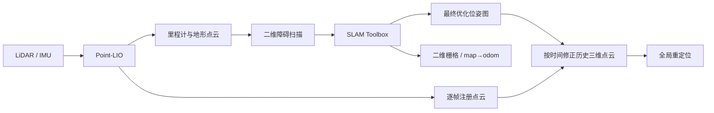

# 使用车辆建图地图测试全局重定位

2026-10-26 本轮实验已按用户要求停止，未跑完 120 组；结果、建图异常证据和交接事项见[建图问题交接记录](slam_mapping_handoff_20261026.md)。以下内容是流程说明，不表示恢复测试。

此流程调用仓库现有的完整 `slam:=True` 建图模式，包括 Point-LIO、地形分析、障碍扫描转换、SLAM Toolbox 和地图保存。三维先验地图来自连续采集的 `/cloud_registered`，按 SLAM Toolbox 最终优化轨迹重建，不使用理想参考 PCD，也不按每帧 Gazebo 真值融合。原有重定位算法及其接受门限保持原样。

原仿真配置关闭了 `use_scan_matching`、`do_loop_closing`、`transform_publish_period`，且 SLAM Toolbox 未显式启用仿真时钟。本流程的 `config/full_slam_mapping.yaml` 启用扫描匹配、回环、变换发布和 `use_sim_time`，并在运行时逐项核验。Point-LIO 保留仓库原始仿真参数。

`loam_interface.anchor_initial_base_frame=true` 将初始底盘锚定在 odom 原点，避免重力对齐后的 Point-LIO 姿态被再次叠加雷达安装角。该参数默认关闭，旧调用行为不变。



## 坐标与评估约定

- 建图节点只读 `/velodyne_points`、`/livox/imu` 等传感器输入；运行时核对 `prior_pcd.enable=false`，记录实际订阅、参数、可执行文件路径及 SHA256。
- 采集路线从已知出生点开始。已有二维占据栅格仅用于离线规划避障路线。默认控制反馈来自 SLAM 的 `map→base_footprint`；`--control-source simulator` 使用独立仿真测试控制器，以真值完成固定路线，避免建图漂移同时中断数据采集。该控制器不发布建图里程计、不修改雷达/IMU、不参与点云融合；manifest 明确标记 `ground_truth_used_for_control`。整条路线连续行驶，不瞬移拼接地图。
- 默认使用 `config/survey_left_loop.json` 的五个采集站点，通过有地面高度记录的平地走廊连接并回到出生点。路径为约 32 m，净空半径 0.55 m；采集站点与 120 项测试位置矩阵独立。可通过 `--survey-waypoints` 指定另一套采集路线。
- 停车后暂停新测量，保存原生 `.posegraph/.data`，读取每个节点的原始扫描时间、里程计位姿和最终优化位姿。SLAM Toolbox 在[原生实现](https://github.com/SteveMacenski/slam_toolbox/blob/jazzy/src/slam_toolbox_common.cpp)中将扫描头时间保存为节点时间。离线以 `C(t)=T_optimized(t)·inverse(T_odometry(t))` 修正注册点云；相邻修正之间插值，超过 3 秒的间隙和图外时间不外推。
- SLAM Toolbox 修正 XY/yaw；Z、roll/pitch 保留 Point-LIO 估计。这是二维位姿图辅助的三维先验。
- 采集结束后，仅使用首个共同时间戳的位姿确定一次 `T_world_slam_map`。不拟合整条轨迹，不做尺度修正、参考地图 ICP 或逐帧真值校正。
- 重定位使用冻结地图和独立采集的扫描。真值只在评估客户端读取，在输出位姿时间戳处对位置线性插值、四元数 SLERP 插值，最大真值间隔 0.25 s，不外推。
- 三维位置误差为平移差的欧氏距离；完整姿态误差为 `R_GT^T R_est` 的 SO(3) 旋转角。另记录平面误差、带符号 XYZ 误差和绕 ±180° 归一化的航向误差。
- 严格正确标准沿用位置 ≤0.10 m 且姿态 ≤2°。统计包含所有有效评分的算法接受结果，包含误定位；拒绝、超时、缺失真值保留在成功率分母中，不填零误差。

## 运行

在仓库根目录执行。Point-LIO 子模块工作树如有删除或改动，隔离构建从该子模块的 HEAD 提取源码，不改写工作树或 index。

```bash
bash tools/global_relocalization/build.bash
bash tools/global_relocalization/build_full_slam.bash
source tools/global_relocalization/environment.bash
source tools/global_relocalization/.build/mapping_ros/install/local_setup.bash
source tools/global_relocalization/.build/full_slam_ros/install/local_setup.bash
export ROS_DOMAIN_ID=182
export GZ_PARTITION=rm27_repository_mapping_182
export FASTDDS_DEFAULT_PROFILES_FILE="$PWD/tools/global_relocalization/config/fastdds_large_cloud.xml"
export FASTRTPS_DEFAULT_PROFILES_FILE="$FASTDDS_DEFAULT_PROFILES_FILE"
bash tools/global_relocalization/start_simulation.bash gui:=false
```

另一个终端加载相同环境和隔离域后，先核验传感器，再运行采集。输出路径必须不存在。

```bash
# 在多套仿真并行、机器负载较高时放慢物理时钟，保留原始传感器频率：
gz service -s /world/default/set_physics/blocking \
  --reqtype gz.msgs.Physics --reptype gz.msgs.Boolean --timeout 10000 \
  --req 'max_step_size: 0.001, real_time_factor: 0.35'

python3 tools/global_relocalization/audit_simulation.py \
  --output /data/run01/simulation_audit.json --duration 6

python3 tools/global_relocalization/full_slam_mapping.py \
  --mapper "$PWD/tools/global_relocalization/.build/mapping_ros/install/point_lio/lib/point_lio/pointlio_mapping" \
  --control-source simulator \
  --output /data/run01/mapping
```

采集器会调用 `rm_navigation_simulation_launch.py slam:=true use_ground_truth_odom:=false navigation_mode:=legacy use_rviz:=false`，沿用原有建图模式。仅设置 `slam:=true` 时，仿真入口默认的 `use_ground_truth_odom:=true` 与建图互斥，需要显式关闭。已有仿真下不要再次启动第二套 Gazebo，也不要同时启动另一个建图节点。

完整模式中的 `fake_vel_transform` 保留运行，但其输出转到 `mapping_nav2_cmd_vel`。手动采集器是 `/cmd_vel` 的唯一发布者，并对此进行审计，避免未接导航目标的停车保护持续抵消采集运动。增大的 Fast DDS 共享内存仅影响传输缓冲区，不改变消息内容或 QoS；默认 512 KiB 段可能小于本场景单帧点云，参见 [Fast DDS 官方说明](https://fast-dds.docs.eprosima.com/en/2.x/fastdds/transport/shared_memory/shared_memory.html)。

采集结束后运行完整矩阵；四个初始朝向各 30 组，共 120 组。

```bash
# 批测前恢复正常物理时钟，建图进程已退出：
gz service -s /world/default/set_physics/blocking \
  --reqtype gz.msgs.Physics --reptype gz.msgs.Boolean --timeout 10000 \
  --req 'max_step_size: 0.001, real_time_factor: 1.0'

python3 tools/global_relocalization/sensor_map_batch.py \
  --node "$PWD/tools/global_relocalization/.build/ros/install/global_relocalization/lib/global_relocalization/global_relocalization_node" \
  --map-dir /data/run01/mapping --output /data/run01/batch120

python3 tools/global_relocalization/report_sensor_map.py \
  --map-dir /data/run01/mapping --batch /data/run01/batch120
```

批测逐项刷新 `summary.json` 和 `results.csv`。中断后，检查未完成项目录，再对同一命令添加 `--resume`。已完成项不重跑；地图、参数、算法二进制或脚本 hash 变化时拒绝混合结果。

## 区分地图与重定位的影响

`paired_map_comparison.py` 用已保存的同一查询云、独立确认云和实际参数，调用同一份冻结的 `libglobal_relocalization_core.so`，只替换目标地图。原始查询元数据不改写；对照结果同时保存采集地图和评估地图的 hash。真值只在 Python 评分器中使用，C++ 估计器不读取真值。

```bash
cmake -S tools/global_relocalization/map_compare \
  -B tools/global_relocalization/.build/map_compare -DCMAKE_BUILD_TYPE=Release
cmake --build tools/global_relocalization/.build/map_compare -j2
python3 tools/global_relocalization/paired_map_comparison.py \
  --batch /data/run01/batch120 --sensor-map /data/run01/mapping/map.pcd \
  --ideal-map tools/global_relocalization/assets/RMUC2026/map.pcd \
  --output /data/run01/paired_maps --watch
```

对原在线已成功输出的组，按原始局部轨迹合成最终底盘位姿，与在线结果核对：误差超过 10 µm 或 0.0001° 时不接受为有效复现证据。原流程在准备阶段拒绝的组没有独立停车确认云，因此只能比较准备是否通过、查询参考位姿是否正确，不能将它们记成完整流程成功。两种地图均通过准备的样本另外使用相同样本集合比较均值。

`audit_sensor_batch.py --batch /data/run01/batch120 --require-complete` 核对全部试验及实际执行文件 hash，并确认每组派生配置仅改变诊断目录，实际运行参数审计全部通过。

## 旧的 Point-LIO 单独重放流程

`replay_sensor_mapping.py` 从录包读取原始 LiDAR/IMU，重新运行同一个点云转换器和 Point-LIO，不播放已记录的估计位姿、注册点云或控制命令。真值仅送入观察者做评分。

```bash
python3 tools/global_relocalization/replay_sensor_mapping.py \
  --bag /data/run01/mapping/raw_bag --output /data/run01/rebuilt_mapping \
  --params src/pb2025_nav_bringup/config/simulation/nav2_params.yaml \
  --pointlio-overrides tools/global_relocalization/config/pointlio_simulation_imu_input.yaml \
  --mapper "$PWD/tools/global_relocalization/.build/mapping_ros/install/point_lio/lib/point_lio/pointlio_mapping"
```

所有新录包使用 `--use-sim-time`，避免 WSL 系统时钟校正影响录制时间。对旧的按系统接收时间录制的包，可先运行 `normalize_sensor_bag.py --input ORIGINAL_BAG --output NEW_BAG`。该操作只按已有消息头时间索引排序，序列化消息内容保持不变；另存审计记录逐话题消息数、无序次数及顺序无关的消息内容 hash，不覆盖原包。不能将未经处理、存在时间倒退的旧包重放结果当作建图算法结论。

## 保留数据

| 文件 / 目录 | 内容 |
|---|---|
| `mapping/map.pcd`、`manifest.json` | 冻结传感器建图地图、来源、固定坐标变换和 SHA256 |
| `mapping/slam.posegraph`、`slam.data`、`graph_optimized.json` | 最终原生位姿图、数据集、优化位姿/原始里程计/原始时间戳及边 |
| `mapping/occupancy.yaml`、`occupancy.pgm` | SLAM Toolbox 原生局部坐标的二维占据栅格 |
| `mapping/full_mapping_audit.json` | 扫描匹配、回环、仿真时钟、变换发布和起点锚定的实际运行参数 |
| `mapping/pointlio_native_map.pcd` | Point-LIO 原生保存的局部坐标地图，若原生保存成功 |
| `mapping/raw_bag/`、`registered_scans/` | 原始传感器、里程计、真值、控制及逐帧注册点云 |
| `mapping/capture.json`、`route.json` | 完整观测轨迹、控制命令、采集帧和连续路径 |
| `mapping/mapping_runtime_parameters.json` | 实际参数、订阅及 Point-LIO 二进制审计 |
| `mapping/mapping_summary.json`、`mapping_errors.json` | 一次起点对齐后的建图轨迹误差，保留地图漂移 |
| `batch120/<trial>/result.json` | 真值和估计的完整矩阵、XYZ、四元数、RPY、误差、状态、资源、控制和确认时间戳 |
| `batch120/<trial>/raw_bag/` | 独立测试的原始传感器、真值、输出、状态及控制 |
| `batch120/<trial>/node.log`、`runtime_parameters.json` | 节点日志和每组参数审计 |
| `batch120/<trial>/raw_diagnostics/`、`query_diagnostics/` | 逐帧局部配准、迭代 trace、查询云、独立确认云及候选检索记录 |
| `batch120/results.csv`、`summary.json` | 逐组结果和总体/初始朝向分组的均值、RMSE、中位数、P95、最大值、失败原因 |
| `batch120/report.html`、`evaluation.png`、`evaluation.svg` | 可独立查看和导出的报告与图表 |

## 仿真边界

当前复用的 Point-LIO 配置和转换器包含既有行为：Gazebo 的 GPU LiDAR 是瞬时扫描，转换器分配合成的 0–100 ms 逐点时间，Point-LIO 按这些时间处理。这一时间模型与真实 MID360 不等价，旋转时可能增加地图误差；这里将其作为现有建图流程的一部分如实记录，不将其产生的误差校正掉。

LiDAR 配置距离噪声标准差为 2 mm，IMU 沿用 Gazebo 默认且未额外加入随机偏置。仿真采用现有重定位测试入口的 Gazebo VelocityControl 驱动适配。此流程能评估“从车辆传感器建成的地图”对重定位的影响，不能替代实车逐点时间、去畸变、驱动和 IMU 噪声验证。开启完整诊断和录包会增加运行开销，耗时结果包含该开销。
